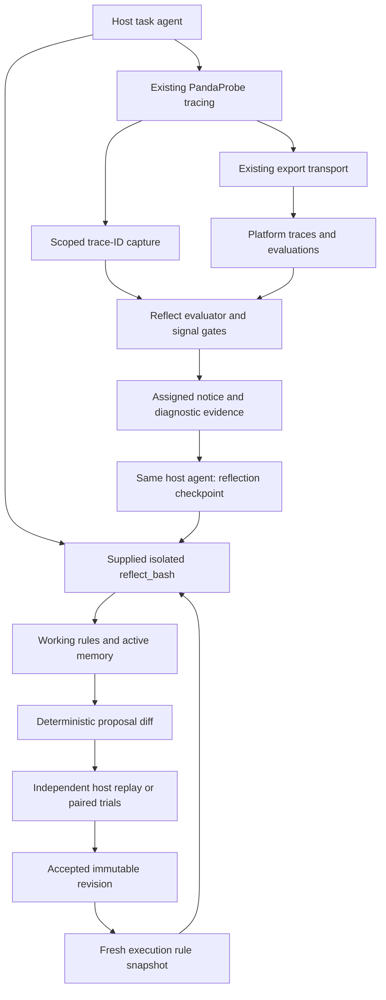

# PandaProbe Reflect for Python — implementation and release report

**Historical baseline:** `pandaprobe` **0.6.0**

**Report date:** 2026-10-26

**Merge commit:** `5e4457171996eecd5b34e0779fb5678798f1eae2`

**Feature branch:** `feat/python-reflect`

**Scope:** the Python SDK implementation, its examples/tests, and associated release evidence.

## 1. Purpose and how to use this report

This report records what was built, how it behaves, why important boundaries
exist, and what was verified for the first integrated Python release of
**PandaProbe Reflect**. It is intended as a durable technical reference for future
coding sessions, refactoring, documentation, research-paper updates, and product
communication. It is a description of the released implementation, not a new
implementation plan or a claim that every original research ambition was achieved.

The baseline was inspected in source and tests. Release status was checked through
GitHub; live-run findings below distinguish local artifacts, earlier cloud-trace
investigations, and automated test evidence. No new paid model/evaluation calls or
test-suite reruns were needed to write this report. Existing TypeScript work and
historical experiment files were left untouched.

The source of truth for future behavior remains the code at the relevant version.
Use this report to understand the 0.6.0 contract, then inspect later changes before
asserting that the same behavior still holds. The original root `plan.md` remains
available in Git history, including `git show eb5f09d:plan.md`; parts of that plan
describe superseded designs. The separate
[TypeScript handoff](typescript-reflect-plan.md) is an implementation plan for the
next language, not evidence of capabilities shipped in this Python release.

Release provenance:

- [PR #32](https://github.com/chirpz-ai/pandaprobe-sdk/pull/32) merged at
  **2026-10-26 06:53:15 UTC**.
- [Release workflow 40282462414](https://github.com/chirpz-ai/pandaprobe-sdk/actions/runs/40282462414)
  completed successfully against the merge commit, including the PyPI publication job.
- [GitHub release `python-v0.6.0`](https://github.com/chirpz-ai/pandaprobe-sdk/releases/tag/python-v0.6.0)
  was published at **2026-10-26 06:58:34 UTC**, as a normal release rather than a prerelease.

## 2. Product capability delivered

PandaProbe's public stack is **Trace → Evaluate → Reflect**. Reflect implements
the operational loop **Detect → Notify → Reflect → Validate**:

1. Observe a developer-owned agent through existing PandaProbe tracing.
2. Evaluate its completed execution evidence with the platform.
3. Detect a configured failure, regression, or stalled trajectory.
4. Present external evidence to the same host agent at a bounded reflection checkpoint.
5. Let that agent propose changes to a persistent rule filesystem.
6. Independently test those changes through host replay or explicitly matched trials.
7. Publish accepted rule revisions for subsequent executions to retrieve.

This changes behavior through context and execution infrastructure. It does not
train model weights, require access to model internals, or add a model-serving
system. The implementation supports standard host agent/model interfaces.

The name **Reflect** deliberately separates proposal generation from successful
behavioral repair. A completed checkpoint can yield no proposal, a duplicate,
invalid changes, operational failure, or a candidate requiring validation. An
accepted change has evidence under tested conditions; it is not a guarantee that
the failure can never recur.

### What changed from the experimental Harness direction

The latest experimental Harness reference used a developer-owned task agent and
a package-owned managed repair agent, with specialized task/admin tools and a
separate PandaProbe CLI dependency for platform operations. The integrated release
adopted different settled choices:

| Concern | Python Reflect 0.6.0 |
| --- | --- |
| Who reflects | The developer's task agent, re-entered at an explicit checkpoint |
| Agent-facing memory tools | One SDK-supplied `reflect_bash` tool |
| Guidance selection | Agent-driven filesystem search/read |
| Active memory | Editable, bounded `context.md`, incorporated at checkpoints |
| Shared acceptance | Independent SDK validator using host-provided outcomes |
| Platform access | Native typed asynchronous HTTP resources |
| Conversation rewriting | Not implemented |
| Core delivery checking | Removed; example-only audit retained |
| Default daily evaluation count cap | None; optional explicit cap |
| Legacy compatibility | No old Harness imports, environment aliases, or bridge package |

Separating task work from a bounded administration checkpoint addresses task
distraction without requiring a second model/agent. That is an architectural
choice, not a demonstrated superiority claim: this work did not run a comparative
benchmark against the original Harness architecture. CLM-inspired filesystem and
active-memory ideas were adopted selectively; its full mechanism or reported
research results were not reproduced as SDK guarantees.

## 3. Distribution, activation, and dependency boundaries

Reflect ships inside the existing **`pandaprobe`** Python distribution:

```bash
pip install "pandaprobe[reflect]"
pip install "pandaprobe[reflect,langchain]"
```

The public namespaces are `pandaprobe.reflect` and the independently useful
`pandaprobe.api`. No separate `pandaprobe-reflect` project or CLI installation is
needed. The Python package remains under `libraries/python/src/pandaprobe/`.
The proposed flattening of that namespace into `src/` was not part of the release.

The SDK requires Python **3.10+** and release CI covers **3.10–3.13**. Framework
minimum versions are separate: DeepAgents requires Python 3.11+, and the example
installation guidance also identifies CrewAI's higher runtime requirement.

Base dependencies remain `httpx` and `pydantic`. The Reflect extra adds:

```toml
reflect = ["bashkit>=0.19.0,<0.20", "filelock>=3.16,<5"]
```

Framework/model libraries remain optional. An extra installs dependencies; it
does not selectively install the source subpackage. Reflect modules are present
in the distribution, but imports do not activate them. Even explicit import of
the public Reflect API is supported without its optional engine installed;
activation fails with an actionable installation error when a required optional
dependency is missing.

Importing ordinary tracing does not import Reflect, create its workspace, start
evaluations, call a model, or install extra framework patches. The runtime starts
only through explicit construction/invocation. Python 3.10 compatibility includes
runtime and cancellation APIs, optional imports, dependencies, and package
resources rather than merely a lowered `requires-python` declaration.

Source: [package metadata](libraries/python/pyproject.toml),
[public Reflect exports](libraries/python/src/pandaprobe/reflect/__init__.py),
[minimal-import test](libraries/python/tests/test_reflect_installation.py).

## 4. Module ownership and architecture



The diagram shows logical ownership; the export worker does not execute the
Reflect evaluator. Platform API access has its own asynchronous HTTP lifecycle.

| Component | Responsibility |
| --- | --- |
| [api/client.py](libraries/python/src/pandaprobe/api/client.py) | HTTP identity, deadlines, safe retries, response/error handling |
| [api/resources.py](libraries/python/src/pandaprobe/api/resources.py) | Trace discovery, visibility, evaluation creation/polling/scores |
| [api/models.py](libraries/python/src/pandaprobe/api/models.py), [errors.py](libraries/python/src/pandaprobe/api/errors.py) | Typed API data and distinguishable failure categories |
| [tracing/capture.py](libraries/python/src/pandaprobe/tracing/capture.py) | Explicit observation of existing trace submissions |
| [reflect/config.py](libraries/python/src/pandaprobe/reflect/config.py) | Feature defaults and input validation |
| [reflect/models.py](libraries/python/src/pandaprobe/reflect/models.py) | Rules, proposals, notices, outcomes, trial records, reports |
| [reflect/workspace.py](libraries/python/src/pandaprobe/reflect/workspace.py) | Durable authority, revisions, atomic writes, locking, proposal diffs |
| [reflect/shell.py](libraries/python/src/pandaprobe/reflect/shell.py) | Isolated general Bash interface, budgets, snapshots, rollback |
| [reflect/execution.py](libraries/python/src/pandaprobe/reflect/execution.py) | One pinned working view, local memory, attribution, sealing |
| [reflect/evaluation.py](libraries/python/src/pandaprobe/reflect/evaluation.py) | Durable scheduling, dispatch claims, usage, evidence gathering |
| [reflect/signals.py](libraries/python/src/pandaprobe/reflect/signals.py) | Threshold, regression, stall, deduplication, cooldown logic |
| [reflect/runtime.py](libraries/python/src/pandaprobe/reflect/runtime.py) | Host orchestration, continuations, explicit waits and cleanup |
| [reflect/validation.py](libraries/python/src/pandaprobe/reflect/validation.py) | Paired replay/trial assessment and independent publication |
| [reflect/integrations.py](libraries/python/src/pandaprobe/reflect/integrations.py), [adapters/](libraries/python/src/pandaprobe/reflect/adapters/) | Lazy native tools, memory integration, permissions, continuation |

## 5. Public API and host integration

The public Reflect exports are:

```text
Reflect, ReflectConfig, Execution, Invocation
Rule, RuleProposal, ProposalOutcome, EvaluationOutcome, ExecutionReport
ValidationVerdict, Outcome, ReplayCase, ReplayRequest, TrialCase, TrialArm
```

The host retains its task model, prompts, tools, framework, business environment,
and existing tracing setup. A typical integration is:

```python
from langchain.agents import create_agent
from pandaprobe.reflect import Reflect

async with Reflect(sdk_client) as reflect:
    agent = reflect.agent(create_agent, model=existing_model, tools=domain_tools)
    result = await reflect.run(
        agent,
        "Do the task",
        session_id="customer-123",
        execution_id="turn-42",
    )
    report = reflect.report("turn-42")
```

This assumes the application's existing tracing integration is already enabled.
Reflect does not infer missing trace evidence from the session name or enable
tracing on its own. Without an independent verifier, this setup can create
proposals but does not automatically accept them.

| Method/interface | Actual responsibility |
| --- | --- |
| `Reflect(client=None, config=None, api=None, replay=None, cases=None)` | Reuses explicit or initialized client; creates feature workspace; optionally registers independent replay |
| `agent(factory, ...)` | Adds the supplied tool and supported native context/permission integration |
| `tool(framework="generic")` | Returns the one tool in the requested native format |
| `bash(command)` | Dispatches to this runtime's currently active execution; no global router |
| `run(agent, input, session_id=..., execution_id=...)` | Runs task and bounded evaluation/reflection path; returns original task result |
| `execution(...)` | Explicit application boundary for custom agents and streams |
| `submit_traces(ids, execution_id=..., session_id=..., completed=True)` | Registers externally completed evidence without requiring a native adapter |
| `wait_export(timeout=...)` | Waits for existing SDK export only |
| `settle_evaluation(id, timeout=...)` | Waits for evaluation; a caller wait deadline can return pending |
| `resume_evaluations()` | Resumes eligible durable pending/cancelled evaluation records |
| `continue_reflection(id, callback, ...)` | Explicit continuation for assigned evidence, including feedback arriving late |
| `settle_reflection(id, timeout=...)` | Waits for an already scheduled checkpoint |
| `validate(id, cases=..., replay=...)` | Schedules independent paired replay |
| `settle_validation(timeout=...)` | Waits separately for scheduled validation tasks |
| `trial_execution(id, arm=...)` | Creates an explicit fresh control/candidate view |
| `validator.record_trial(id, case)` | Records matched, host-verified trial evidence |
| `report(id)`, `proposals()` | Reads lifecycle/evidence state |
| `aclose()` / async context manager exit | Cancels owned work and closes owned HTTP resources |

The generic callback accepts an `Invocation` containing `input`, `execution`,
`phase`, `previous_result`, `feedback`, and an `instructions` property. It is
asynchronous and owns actual model invocation. A custom host must supply the
instructions/tool to its model and respect the reflection-phase restrictions.
There is no claim that an arbitrary precompiled graph can gain new tool nodes
without host integration.

## 6. Execution and reflection lifecycle

### 6.1 Identity and working view

An execution ID identifies one invocation; a session ID groups related work.
Constructing an execution pins the currently accepted revision and creates a
separate shell. A normal task starts from accepted rules. Same-session active
memory is reused only when its recorded accepted revision still matches.

Each execution checkpoints working file contents, active memory, memory hash,
whether memory is unvalidated, base revision, task/processing status, candidate
IDs, usage counters, and task/reflection/validation trace IDs. Restoring a
reflection continuation restores that working state and its output allowance;
it does not allocate a fresh unlimited tool budget.

### 6.2 Task completion

The execution boundary encloses actual work and, for streams, consumption through
completion. On exit it captures phase attribution, records task success/failure
as operational status, seals working rule changes, schedules registered validation
for a new proposal, submits task trace references, and closes the shell.

`completed=True` describes application finality for signal gating, not whether
the business objective succeeded. A failed task can still have terminal evidence
worth evaluating. If task invocation raises, `run()` does not manufacture a
successful result or automatically invoke the reflection continuation; the
original exception propagates. Cleanup errors are logged rather than replacing
the task's result/exception.

Task-time rule edits are also proposal candidates. There is no rule that only a
failure checkpoint may author changes. The independence of acceptance applies
to all change sets regardless of their authoring phase.

### 6.3 Evidence and checkpoint

After normal task return, `run()` awaits the evaluation/notice path. If a notice
exists, it durably claims reflection for that execution, restores its working
view, mounts assigned evidence, and invokes the same host agent with bounded
feedback. The prompt tells it to compare judge explanations with execution
evidence, search existing rules, make at most one coherent improvement/maintenance
change set, or leave rules unchanged when uncertain/already covered/unactionable.

Native adapters restrict reflection to filesystem administration. The agent is
not asked to rerun business tools, poll for validation, acknowledge a mailbox,
or decide its own proposal's status. The task agent's existing implementation and
model are reused; native conversation continuation differs by framework.

Reflection records one explicit `ProposalOutcome`. Its model rationale is kept
separate from the SDK's reason. Reflection timeout/failure/no-proposal cannot
replace a successful task answer. A terminal container record with
`reflection.status="completed"` means checkpoint processing ended; the nested
outcome is what says proposed, failed, cancelled, and so on.

### 6.4 Scheduling, recovery, and cancellation

Evaluation, reflection, validation, and host continuations have separate task
tracking. Validation is not awaited while the original task barrier holds
resources that replay may need. A registered `cases`/`replay` pair schedules
validation automatically, but the host calls `settle_validation()` after releasing
its resources. Without the pair, proposals await explicit validation/trials.

Durable reflection claims avoid repeating administration across instances or
restarts. An interrupted claimed continuation is not silently retried because
host code may have side effects. Late evaluation does not resurrect an agent:
the host must explicitly provide a continuation.

Caller timeouts on settlement waits do not necessarily cancel the underlying
work; for example, `settle_reflection()` can return timed out while the checkpoint
continues. Runtime shutdown does cancel owned work and waits only up to its
shutdown deadline. `_call_host()` bounds waiting even if a callback delays
cancellation, tracks the remaining task, and observes its eventual exception.
The shell closes so late tool calls cannot keep changing it. Arbitrary host code
cannot be forcibly killed, and provider requests already accepted cannot be undone.

## 7. Preserving tracing: what TraceCapture adds

The existing SDK still owns provider/framework instrumentation and export.
The additive [TraceCapture](libraries/python/src/pandaprobe/tracing/capture.py)
interface observes trace submissions at `Client.log_trace()` through
`Client.capture_traces()`.

TraceCapture:

- Does not create traces, patch frameworks, poll storage, or run evaluation.
- Uses a client-owned `ContextVar` scope, collects distinct IDs up to a bound,
  and exposes overflow explicitly.
- Adds capture metadata/session attribution to a copied export payload rather
  than mutating the caller's original trace object for this purpose.
- Restores an outer capture when a nested scope exits.
- Keeps inherited attribution for late descendant submissions while refusing to
  add their IDs to an already closed boundary.
- Isolates optional submission-observer failures from task/export behavior.

Reflect uses a separate instance-local `ContextVar` to route its supplied tool.
There is no process-global last-active Reflect instance. Task, reflection, and
validation phases carry `pandaprobe.reflect` metadata containing role, execution
ID, and original task session ID. Internal phases use separate trace session
attribution such as `reflect:reflection:<execution-id>`.

The evaluator excludes evidence marked as reflection or validation. Their work
remains traceable/cost-visible; it simply does not recursively become task failure
evidence. Missing cost telemetry does not imply zero operational cost.

Export, backend persistence, and score availability are separate waits. The
existing export transport was not replaced with a reflection worker. The
submission observer is a general capture hook, not a core model-input inspection
or rule-delivery hook.

Tests: [test_trace_capture.py](libraries/python/tests/test_trace_capture.py).

## 8. Native platform API and safe evaluation creation

`pandaprobe.api.PlatformClient` is usable independently of Reflect. It accepts an
existing SDK client or resolved configuration and otherwise uses the normal SDK
configuration path. Explicit configuration wins; users do not configure a second
identity. It owns a separate `httpx.AsyncClient`, sends `X-API-Key` and
`X-Project-Name`, and disables redirects to avoid credential forwarding.

Endpoint validation requires HTTP(S) and rejects URL credentials, query, and
fragment. Resources validate requested/retrieved identities. API models allow
additive server fields while requiring meaningful existing fields and statuses.

| Resource operation | Endpoint relative to configured base |
| --- | --- |
| `traces.list()` / `iterate()` | `GET traces` with pagination/session/status filtering |
| `traces.get()` / `wait_visible()` | `GET traces/{trace_id}` |
| `evaluations.metrics()` | `GET evaluations/trace-metrics` |
| `evaluations.create()` | `POST evaluations/trace-runs/batch` |
| `evaluations.get()` | `GET evaluations/trace-runs/{run_id}` |
| `evaluations.scores()` | `GET evaluations/trace-runs/{run_id}/scores` |
| `evaluations.wait()` | Polls existing run/status and then verifies its score matrix |

There is no CLI subprocess bridge or authentication requirement. CLI reads used
during development investigations were operator diagnostics, not runtime calls.
Monitor CRUD and scheduled monitor orchestration were excluded from the first release.

### Read/retry behavior

The API defaults to a 30-second operation budget and three GET attempts. Safe
reads retry selected transport/status failures within a monotonic deadline.
Backoff uses jitter; `Retry-After` supports seconds or HTTP date and is bounded.
Cancellation propagates without retry. Auth, not-found, rate-limit, transport,
deadline, invalid response, failed evaluation, and insufficient evidence have
distinct error types.

Trace visibility polling tolerates a not-yet-persisted trace and waits for a
terminal `COMPLETED` or `ERROR` record. Evaluation polling uses one run ID, fails
on terminal failed/cancelled runs, and does not treat `COMPLETED` alone as success.
Every expected trace/metric pair needs a unique successful finite numeric score
from that run. Duplicate, missing, failed, wrong-run, or unusable scores prevent
usable completion. Reflect additionally requires normalized `[0,1]` signal values.

### Creation uncertainty and durability

The backend contract inspected for this release had no evaluation-creation
idempotency-key support. The implementation therefore makes **one POST attempt**,
not a retry loop:

1. Persist a `creating` claim for the execution/stage/trace/metric identity and
   charge the creation attempt before dispatch.
2. Send the POST once.
3. Persist its returned run ID immediately, without another await in between.
4. Poll that run on subsequent waits and after restart.

A transport timeout, ambiguous server response, malformed success response, or
cancellation can leave `creation_unknown`. A crash leaving a claim without an ID
also prevents a replacement create. This avoids automatic duplicate potentially
billable runs, but cannot recover an unknown server-generated ID. Operator
reconciliation or future backend idempotency is needed. Request IDs do not provide
this guarantee, and the SDK does not claim exactly-once server execution.

OpenAPI-derived contracts are pinned in
[platform_contract.json](libraries/python/tests/fixtures/platform_contract.json)
and checked by [test_api.py](libraries/python/tests/test_api.py). The development
script [update_platform_contract.py](libraries/python/scripts/update_platform_contract.py)
extracts relevant operations and transitive schemas from an OpenAPI export. A
stale backend schema discovered during implementation used `total_traces` where
current routes used `total_targets`; fixtures were regenerated from current
`app.openapi()`. Backend implementation modules are not imported by the SDK/tests.

## 9. Detection, diagnostics, budgets, and evidence

### 9.1 Evaluator scheduling

The evaluator normalizes and sorts trace UUIDs, requires execution/session IDs,
and persists the exact request policy. Reusing an execution ID with different
evidence or thresholds is invalid. Trace ownership prevents the same trace being
submitted under another execution ID to create new billable runs. In-flight work
is single-flight per runtime, and durable claims coordinate run creation across
instances sharing a workspace.

Before evaluation it checks empty evidence, the trace-count limit, and deterministic
sampling derived from the execution-ID digest. A per-runtime semaphore bounds
concurrent evaluation orchestration. Persisted traces are fetched and internal
roles excluded. Primary evaluation uses configured threshold metrics; the worst
score across traces for each metric represents that application boundary.

### 9.2 Signal semantics

The signal gate requires complete finite normalized scores. It persists bounded
session history and notice cooldowns. Repeated observation of one execution does
not create a trajectory.

For each metric, the implementation's ordered conditions are:

1. A completed execution below threshold produces `below_threshold`.
2. Otherwise, a sufficiently large drop from the preceding score while below
   threshold produces `regression`.
3. Otherwise, a below-threshold window with variation below `minimum_progress`
   produces `stalled` when enough history exists.

Cooldowns filter repeated signatures. This matters for interpreting results:
completed low scores use the first condition rather than simultaneously being
classified as all three types. An intermediate low score alone need not be a
final failure. Missing scores are not success and are not invented measurements.

### 9.3 Diagnostics and evidence

A notice can trigger tool/argument diagnosis. Failure or budget exhaustion of
diagnostics does not erase the primary scores or notice. Evidence stores primary
and diagnostic results before potentially large raw trace payloads, clips to a
configured byte limit with a visible truncation marker, and preserves original
trace/run IDs so complete records can be investigated later.

The notice includes execution/session identity, task trace IDs, scores, reasons,
signatures, and timestamp. Judge explanations are explicitly presented as fallible
evidence. The package does not treat their narrative as authoritative business
truth or sufficient validation of a proposed correction.

### 9.4 Daily usage accounting

There is **no default daily evaluation count cap**:
`ReflectConfig.evaluation_max_runs=None`. The early implementation's default
100-run cap was removed after review.

An opt-in positive integer caps creation attempts per UTC day within the same
identity workspace, across restarts and instances. Detection and diagnostics each
consume an attempt. Failed and uncertain attempts count; polling an existing run
does not. Usage is tracked even while uncapped, so enabling a cap later includes
earlier attempts that day. Zero is not an unlimited sentinel.

At the cap, a new detection run is skipped with count/limit/reset information in
its reason/log/report/event. Diagnostic exhaustion retains the primary evidence.
Existing guidance and task execution remain available, and existing run polling
continues. UTC midnight resets admission for new requests; a previously skipped
execution is not automatically retried. The cap is a local usage proxy, not a
platform quota, provider limit, or monetary budget. Shared instances must use
consistent cap configuration.

Source/tests: [evaluation.py](libraries/python/src/pandaprobe/reflect/evaluation.py),
[signals.py](libraries/python/src/pandaprobe/reflect/signals.py),
[test_reflect_evaluation.py](libraries/python/tests/test_reflect_evaluation.py).

## 10. Rule filesystem, durable storage, and active memory

### 10.1 General shell interface

`reflect_bash(command: str) -> str` is the sole agent-facing Reflect tool. Its
description explains ordinary search/read/edit operations and the virtual paths.
Python uses Bashkit 0.19 with built-in utilities and a virtual filesystem; it
does not launch the host's Bash. Common grep/find/cat/sed/awk operations, pipes,
redirection, loops, heredocs, directory creation, moves, and deletion are available.

There are no host mounts, inherited API credentials, network access, external
program execution, or embedded Python execution. Each execution owns its own
interpreter and serializes calls with an async lock.

| Agent-visible path | Purpose and access |
| --- | --- |
| `/rules/**/*.md` | Read/write working rule snapshot |
| `/context.md` | Read/write bounded active notes |
| `/inbox/notice.json` | Read-only assigned failure notice |
| `/inbox/evidence.txt` | Read-only assigned diagnostic evidence |
| `/decisions/status.json` | Read-only recent proposal/decision summaries |

The authoritative host workspace is not mounted into the shell. These virtual
paths are not directories at the root of the user's computer. Scratch files and
interpreter state can exist during an invocation; the durable export focuses on
working Markdown rules, active memory, and bookkeeping rather than a complete OS image.

Commands are bounded by input bytes, interpreter limits, timeout, per-output bytes,
and cumulative output bytes. Entering reflection adds an eight-tool-call budget
by default relative to the existing command count. Output includes stdout/stderr,
exit code, active-memory size, and explicit truncation information. Repeated guard
or error replies consume the same allowance. Closed/exhausted boundaries can
return empty output, so an empty text field alone is not proof of a broken tool.

Before execution, the shell snapshots its state. Cancellation/timeouts trigger
interpreter cancellation and snapshot restoration; interpreter errors and invalid
filesystem exports also roll back. Evidence mounts remain read-only across these
paths. Rule enumeration bounds entries/depth, rejects symlinks/nonregular files,
validates relative names, and enforces file/count/corpus limits. Markdown semantic
validation occurs when creating `Rule` records at sealing; not every intermediate
editing command must leave a fully authored rule.

The supplied tool's isolation does not defend against unrelated host tools with
the same OS privileges. If a developer separately gives an agent unrestricted
host filesystem access, authoritative workspace permissions remain a host concern.

### 10.2 Rule schema and deterministic identity

A rule is a Markdown file with a title, explicit applicability, and guidance:

```markdown
# Refund merchandise only
Applies to: authorized standard-return refund settlement
Use the merchandise-paid amount; exclude nonrefundable outbound shipping.
```

`Rule` validates a relative Markdown path with restricted characters and length,
normalizes CRLF to LF, strips outer whitespace, and adds one trailing newline.
It requires a `# ` title, an `Applies to: ...` line, at least three lines, and no
NUL. The version is SHA-256 of normalized UTF-8 text. Directory parent is scope;
root-level files use `global`. Applicability remains text, not an executable
predicate or deterministic routing system.

A proposal is the diff of the entire working snapshot against its pinned base:
new/changed files contain Rule records; removals are `None`. A move is represented
by deletion plus addition. No diff yields `no_proposal`. Identical normalized
guidance under a different filename can be classified duplicate, and deterministic
base/change-set fingerprints prevent repeated consideration of the exact diff.
This is exact/normalized duplication detection, not semantic conflict resolution.

### 10.3 Durable workspace authority

The default host layout is:

```text
.pandaprobe/reflect/<identity-namespace>/
  .lock
  state.json
  revisions/<revision>/manifest.json
  revisions/<revision>/rules/**/*.md
  executions/<sha256(execution-id)>.json
  evidence/<notice-id>.txt
  events/<event-id>.json
```

The namespace is the first 24 hex characters of SHA-256 over endpoint without
trailing slash, project name, and API key, separated by newlines. Plaintext
credentials are not the directory name. Different credentials/projects/endpoints
are partitioned; credential rotation creates a different namespace. This is local
partitioning, not an authentication boundary against a host administrator.

`state.json`, schema version 1, holds accepted head, proposals/decisions,
evaluation dispatch/results, usage day/count, trial evidence, signal history,
notices, execution requests, trace ownership, and session memory. Revisions store
path-to-rule-version manifests and immutable accepted file contents. To find
accepted rules, follow `state.json` → `head` → that revision's `rules/`.

State updates use FileLock across processes and temporary-file + flush/fsync +
atomic replacement. A new immutable revision is written completely before the
head pointer is updated. A crash may leave an unreferenced revision but not a
half-published accepted snapshot. Revision reuse/read verifies manifest and text
hashes and rejects link escapes. Missing authoritative state with nonempty history
is not silently reinitialized. Events and execution snapshots are separately
written records; the accepted state pointer is the authority, not an assumption
that every event and snapshot participates in one database transaction.

The manifest hash uses sorted, compact, Unicode-preserving JSON. Other hashes
such as evaluation claims and replay inputs use their own source serialization
paths. Ports must inspect those exact functions rather than assume one generic
JSON serialization reproduces every digest.

Concurrent proposals/acceptance are checked against base revision. Stale proposals
cannot overwrite a newer accepted head. Active-rule limits do not prune historical
revisions, evidence, or events. Operators own archival, retention, permissions,
disk monitoring, and backups. The implementation assumes local filesystem lock
and atomic-rename semantics; object storage is not an interchangeable backend.

### 10.4 Active memory and retrieval

`Execution.instructions()` produces a fixed instruction preamble and, when
nonempty, one `<reflect_active_memory>` block containing `context.md`. Native
integrations refresh/replace this at their supported checkpoints. They do not
automatically insert all accepted rules or rank relevant files.

The agent retrieves guidance using ordinary commands. Storing a rule alone does
not make a model consume it. Memory-only edits can persist to the same session
at the same accepted revision. Memory associated with unvalidated rule edits is
not propagated into a fresh ordinary view, and validation controls start with
fresh local memory. Active notes are recorded as unvalidated, not promoted as
shared rules. Conversation history itself is not rewritten or compressed.

Byte/count limits constrain the supplied tool and stored active corpus. They do
not bound the framework's accumulated history, all tool definitions, other host
tools, or the model's total tokenizer-dependent context.

Sources/tests: [workspace.py](libraries/python/src/pandaprobe/reflect/workspace.py),
[shell.py](libraries/python/src/pandaprobe/reflect/shell.py),
[execution.py](libraries/python/src/pandaprobe/reflect/execution.py),
[workspace tests](libraries/python/tests/test_reflect_workspace.py),
[real-shell tests](libraries/python/tests/test_reflect_shell.py).

## 11. Proposal and outcome records

Core lifecycle records are typed and generally frozen, with unexpected fields
forbidden. This validates shape; it is not a security boundary against arbitrary
trusted host code or a claim of deep immutability of all nested Python values.

| Record | Key information |
| --- | --- |
| `Rule` | Relative path, normalized text; derived version/scope/applicability |
| `RuleProposal` | ID, base revision, file changes, fingerprint, session/execution, evidence IDs, time, status, rationale, decision |
| `FailureNotice` | Assigned execution/session/traces, normalized scores, reasons, signatures, time |
| `EvaluationOutcome` | Execution, status, known run IDs, scores, optional notice, reason |
| `ProposalOutcome` | Generation status, optional proposal, SDK reason, agent rationale |
| `ValidationVerdict` | Proposal, accepted/rejected/pending, reason, replay/trial mode, cases, time |
| `Outcome` | Host-verifier scores, explicit boolean-or-None success, independent evidence |
| `TrialArm` / `TrialCase` | Assignment, execution IDs, outcomes, input/base identity, protected status |
| `ExecutionReport` | Task status, trace IDs, evaluation, reflection outcome, related proposals |

Status sets are intentionally separate:

```text
EvaluationOutcome:
  evaluated | skipped | pending | insufficient | failed | creation_unknown | cancelled

ProposalOutcome:
  proposed | duplicate | no_proposal | invalid | conflict | timed_out | failed | cancelled

RuleProposal lifecycle:
  candidate | pending | accepted | rejected

ValidationVerdict:
  accepted | rejected | pending
```

Neither a proposal ID nor successful checkpoint completion is a `repair_success`
flag. Agent explanations are clipped and retained as rationale, not converted
into verified outcomes. Core reports contain no delivery receipt fields.

## 12. Independent acceptance algorithm

The proposing agent can edit working files but cannot promote or retire proposals
through its tool. The independent validator owns shared publication. Trusted host
Python code supplies verifiers and has normal library/OS authority; this separation
does not purport to protect against a malicious host modifying its own storage.

### 12.1 Replay collection

`ReplayCase` supplies a stable ID, JSON-serializable input, and protected flag.
`ReplayRequest` contains that case, a fresh execution, and control/candidate arm;
its `run()` invokes the host agent without recursive task evaluation.

For each case, the validator pins the proposal's base revision, starts fresh
execution/session/local-memory state, and assigns either baseline or candidate
rules. Arm order alternates deterministically from the case-ID digest. The host
must provide fresh business state and independent expected outcomes; the SDK
cannot reconstruct an arbitrary environment from recorded traces.

The callback returns `Outcome(scores, success, evidence)`. Scores reject booleans,
numeric strings, nonfinite/out-of-range values, and empty metric names; success
must be a real boolean or absent. Inputs/evidence must be serializable without
NaN. The validator records input hash, baseline, IDs, assignment, scores, success,
and evidence, and rejects a replay that modified its assigned rule snapshot.

### 12.2 Assessment, in order

The release algorithm in [validation.py](libraries/python/src/pandaprobe/reflect/validation.py)
applies these checks:

1. Require the configured number of distinct paired cases, by default three.
2. Require at least one protected case.
3. Require matching base revision, both arms, distinct non-reused execution IDs,
   all configured metrics, finite normalized outcomes, and explicit boolean success.
4. Require empty candidate assignment for control and exactly this proposal for
   candidate; paired metric sets must be equal.
5. A protected control must still succeed. Otherwise protection is insufficient.
6. A successful control becoming an unsuccessful candidate rejects the proposal.
7. A metric regression beyond tolerance on any case rejects it.
8. Compute the mean metric delta across non-protected comparisons. If it reaches
   `validation_min_improvement`, accept with a measured-improvement reason.
9. Otherwise, if the candidate reduces total UTF-8 guidance bytes while passing
   the preceding outcome/regression checks, accept as measured non-inferiority
   maintenance, explicitly making no behavioral-improvement claim.
10. Otherwise leave the proposal pending for insufficient improvement/evidence.

This is a deterministic finite-case policy, not a statistical significance test
or a proof of causal generalization. A positive mean does not mean every failure
case needed the rule. Representative cases and independent verifiers are host
responsibilities. The validator does not semantically prove rule applicability.

### 12.3 Publication, live trials, and interruption

Acceptance writes a new immutable revision and moves head under the workspace
lock. If head changed during validation, the outcome becomes pending for rebase
and revalidation. Accepted/rejected proposals are terminal to the normal validator.
Cleanup/removal uses the same validation path as additions.

`trial_execution()` creates explicit control/candidate views for forward trials.
`record_trial()` accepts matched host-attested evidence, not unrelated later
successes. Identical repeated cases are idempotent; a case ID cannot be replaced
with different evidence. Reused execution IDs and invalid assignments fail assessment.

Host errors, timeout, or cancellation leave partial evidence/pending rather than
acceptance. Replay settlement is separate from task settlement. No verifier means
no measured publication; no trace-only automatic replay is supplied.

Tests: [test_reflect_validation.py](libraries/python/tests/test_reflect_validation.py),
including acceptance from a partial unformatted excerpt, missing outcomes,
protected regressions, altered snapshots, stale heads, removals, and resource
barrier/cancellation behavior.

## 13. Native framework adapters

All adapters are loaded lazily by explicit use. They format the supplied tool,
compose memory/context, preserve task settings, bound reflection, and implement
native continuation. They do not install a second tracing layer.

| Framework | Implementation details |
| --- | --- |
| LangChain | Native StructuredTool; one stable-ID system memory message; middleware filters reflection tools and blocks domain tool execution |
| LangGraph | Message-state invocation plus native prebuilt ToolNode/prompt composition; explicit unsupported-hook error; validation gets fresh thread ID |
| DeepAgents | LangChain-family integration with special care for checkpoint-owned history and tool reply identity |
| OpenAI Agents | Invocation-local cloned agent, composed dynamic instructions, supplied function tool; reflection restricts tools/handoffs; fresh validation conversation required |
| Google ADK | Native FunctionTool, dynamic instruction composition, model/tool permission callbacks, Runner/session service, materialized event stream |
| CrewAI Agent/Crew | Copied native objects, noncached BashTool, async/thread-loop bridge; final task's explicit agent reflects instead of rerunning a whole crew |
| Claude Agent SDK | MCP tool/server, native client lifetime inside execution scope, session resume for reflection, fresh validation options, error-result recognition |

### Framework-specific boundaries

- **LangChain family:** memory uses stable ID `pandaprobe-reflect-active-memory`.
  Native reflection checks checkpoint history first. If it exists, only feedback
  and current memory are submitted as updates; if absent/cleared, prior result
  messages can supply continuation. Existing callbacks and other graph state are
  retained. Custom compiled graphs still need explicit integration.
- **OpenAI Agents:** persistent sessions own history, so reflection supplies only
  new feedback. Without such a session it can continue the previous result's input
  list. Validation rejects persistent session/conversation/previous-response IDs.
- **ADK:** original instruction providers may be synchronous/asynchronous.
  Reflection changes advertised function declarations and denies non-Reflect
  execution through the tool callback. Validation uses fresh execution identity;
  existing Runner agents must already have the supplied tool configured.
- **CrewAI:** tool execution returns to the owning event loop rather than a global
  runtime router. Caching is disabled for mutable filesystem operations.
  Reflection disables delegation/code execution and bounds iterations. A Crew
  needs an explicit agent on its final task for the selected continuation path.
- **Claude:** task MCP/options are preserved on copies; reflection restricts native
  tools and MCP servers and resumes the task's session. Validation clears resume
  and conversation flags. Native terminal error values raise with subtype and
  provider detail, so they do not masquerade as successful task answers.

The locked native testing baseline included LangChain 1.3, LangGraph/Prebuilt 1.x,
DeepAgents 0.6.1, OpenAI Agents 0.13.x, ADK 1.33, CrewAI 1.6, and Claude Agent SDK
0.1.50. This is a tested-version statement, not a promise that every historical
version allowed by a broad optional dependency range supports every Reflect hook.
The earlier implementation log also records selected newer-version probes; those
are not an exhaustive future-compatibility guarantee.

## 14. Defaults and their precise scope

The table describes SDK defaults, not live-example overrides. Time values are
seconds. Byte limits use UTF-8; KiB/MiB are powers of 1024.

| Field | Default | Scope |
| --- | --- | --- |
| `workspace` | env `PANDAPROBE_REFLECT_WORKSPACE` or `.pandaprobe/reflect` | Base directory, then identity partition |
| `trace_visibility_timeout` | 30 | Persisted terminal trace wait |
| `evaluation_timeout` | 120 | Evaluation create/wait operation budgets |
| `poll_interval` | 1 | Evaluator polling |
| `evaluation_max_runs` | `None` | Optional daily creation-attempt cap |
| `evaluation_max_traces` | 32 | One execution's evaluable traces |
| `evaluation_sample_rate` | 1.0 | Deterministic execution sampling |
| `max_concurrency` | 4 | Evaluator concurrency per runtime |
| `cooldown_seconds` | 60 | Repeated failure signatures |
| `reflection_timeout` | 60 | Host reflection continuation |
| `shutdown_timeout` | 5 | Runtime cancellation wait |
| `reflection_max_commands` | 8 | Tool invocations during checkpoint |
| `shell_timeout` | 5 | Interpreter command deadline |
| `shell_max_commands` | 2,000 | Interpreter command limit |
| `shell_max_loop_iterations` | 5,000 | Interpreter loop limit |
| `shell_memory_bytes` | 16 MiB | Interpreter memory |
| `command_max_bytes` | 16 KiB | Supplied command input |
| `output_max_bytes` | 12 KiB | One tool response |
| `execution_output_max_bytes` | 96 KiB | Total responses, including guards/errors |
| `context_max_bytes` | 8 KiB | Active-memory file |
| `rule_max_bytes` | 8 KiB | One Markdown rule |
| `rules_max_bytes` | 512 KiB | Active working corpus |
| `rules_max_count` | 256 | Active rule files |
| `evidence_max_bytes` | 64 KiB | Assigned diagnostic presentation |
| `thresholds` | task completion 0.5; coherence 0.5 | Primary normalized metrics |
| `diagnostic_metrics` | tool correctness; argument correctness | Follow-up diagnosis |
| `stall_window` | 5 | Session trajectory window |
| `minimum_progress` | 0.02 | Stall variation cutoff |
| `regression_drop` | 0.15 | Previous-score drop cutoff |
| `validation_min_cases` | 3 | Distinct paired cases |
| `validation_min_improvement` | 0.05 | Mean non-protected metric delta |
| `validation_regression_tolerance` | 0.02 | Allowed metric drop |
| `validation_timeout` | 120 | Replay collection deadline |

Configuration checks finite positive timeouts/counts, probability/range bounds,
nonnegative cooldown, and nonempty threshold mappings; integer limits reject
booleans. The threshold mapping is copied from the caller. Shared platform
identity uses existing core settings. No `HARNESS_*` aliases or separate
`reflection_model` setting were introduced.

## 15. Delivery checking: removed design versus released behavior

Early work introduced rule-body matching and delivery receipts into the runtime.
A live LangChain run generated and independently validated a rule and completed
a fresh correct task, but the demonstration's checker could not establish
delivery from the particular tool representation. Numbered grep handling was
added, then reviewed with the user.

The final decision was to keep the runtime minimal and remove this policy from
core. Release 0.6.0 contains no core `delivery.py`, `DeliveryReceipt` export,
model-input observation hooks, persisted delivery records, or whole-file
acceptance requirement. Framework callbacks/wrappers used solely for that
inspection were removed. The independent validator still checks fresh assignment,
verified outcomes, protected regressions, frozen snapshots, and revision conflicts.

The separate [example audit](libraries/python/examples/reflect/_support/delivery.py)
remains useful for demonstrating the full sequence in tests. It reads existing
task LLM inputs from traces or example-owned native observations, verifies source
text/version/timing, and keeps partial versus full coverage separate. The current
failure milestone accepts a verified excerpt before the first refund submission.

Relevant distinctions:

- A rule is present/discoverable.
- A tool returned some text.
- A subsequent task-model input contained verified text before the action.
- The business outcome succeeded.
- Paired validation showed measured improvement under tested conditions.

None of these facts automatically proves the next. Partial text can be sufficient
for useful behavior; requiring every title/applicability/guidance line was too
conservative for core acceptance. Conversely, a filename or a successful tool
call alone does not prove text reached a model. The example audit records what it
can observe without making that observation a runtime gate.

[numbered_grep.json](libraries/python/tests/fixtures/reflect/numbered_grep.json)
is a test-only regression fixture, not part of the installed SDK logic. Historical
workspaces can retain receipt files from earlier development versions. They were
not rewritten or relabeled when the design changed.

## 16. Examples and independent business verifiers

### 16.1 Offline complete-loop example

[offline_demo.py](libraries/python/examples/reflect/offline_demo.py) starts a
loopback-only HTTP fixture and exercises real SDK trace export, native API reads,
evaluation polling, Bash operations, proposal creation, independent replay,
acceptance, and retrieval in a fresh execution. It uses a deterministic agent and
arithmetic verifier, makes no paid model calls, and cleans up its temporary workspace.
It establishes orchestration behavior, not model-level repair performance.

### 16.2 Live support queue

Each of the seven framework example directories has `04_reflect.py`. Shared
[_support/scenario.py](libraries/python/examples/reflect/_support/scenario.py),
[runner.py](libraries/python/examples/reflect/_support/runner.py), and
[agents.py](libraries/python/examples/reflect/_support/agents.py) provide a fictional
customer-support workload with six conversations by default and three turns per
conversation: inspect, resolve, repeat. The local ledger independently checks
policy/authorization/idempotency behavior. It can legitimately finish without
failures or proposals, which is useful for verifying the healthy path.

### 16.3 Controlled stale-runbook failure

Each framework also has `05_reflect_failure.py`, sharing
[refund_incident.py](libraries/python/examples/reflect/_support/refund_incident.py)
and [failure_runner.py](libraries/python/examples/reflect/_support/failure_runner.py).
This is an intentionally induced policy mismatch, not a naturally sampled
production-failure benchmark:

1. A stale fallback says to refund invoice total when no applicable learned
   update exists. The simulated service actually refunds merchandise only.
2. `INCIDENT-101` has 6,500 cents merchandise and 700 shipping. A 7,200-cent
   submission is rejected and closes the batch; the same task cannot retry it away.
3. Platform scores must generate a real failure notice. The task agent reads
   evidence and authors a reusable rule without a preseeded solution file.
4. Independent paired replay tests 4,200 + 1,200 shipping, 11,300 + 300 shipping,
   and a protected 2,700-cent free-shipping case. Every arm has fresh model/session,
   memory, and business state; only its assigned rule snapshot differs.
5. After acceptance, a new runtime and fresh agent reopen the persisted workspace.
   `FRESH-501` should refund 9,250 merchandise cents and exclude 850 shipping.
6. The report separately tracks initial failure, platform detection, proposal,
   acceptance, observed retrieval, and verified fresh task outcome.

The ledger checks read-before-write, valid identity, integer amounts, one allowed
submission, and actual posted/rejected state independently of the model's claim.
Pending/rejected validation and missing milestones stop the demonstration. There
is no retry-until-success/acceptance loop. Partial reports preserve exceptions.

Current workload version is 4. Live-example overrides include a 360-second task
wait, 90-second reflection checkpoint, 600-second replay limit, and task-completion
threshold 0.8. These are not the SDK defaults. Scripts expose model/output/timeout
controls, use new workspaces for controlled-failure runs, and provide help without
credentials or importing unavailable frameworks.

Model defaults were updated across Python examples to `gpt-6-luna`,
`gemini-3.8-flash`, and `claude-haiku-5-5` where applicable. Provider/framework
settings are example concerns. In particular, the Claude Reflect examples disable
thinking and use low effort for compatibility with the installed older native
runtime; core Reflect does not override the host's thinking settings.

## 17. Live-run evidence ledger

Reports were inspected under
`libraries/python/.pandaprobe/reflect-examples/<framework>/<run-id>/report.json`.
These local, normally ignored artifacts may not exist in another checkout; IDs
below preserve the lookup trail. Raw reports retain their original outcomes.

Most runs record SDK version **0.5.0** because they exercised the in-development
editable implementation before the release bump. They are evidence from Reflect
development, not runs to relabel as published 0.6.0 or as old Harness benchmarks.

| Framework / run | Recorded result | What is established and what is limited |
| --- | --- | --- |
| LangChain support `5d3c94e8915f` | Completed; 3 turns | Healthy short support path; no validation event required |
| LangChain support `c0332c1a87cb` | Completed; 18 turns | Healthy default support queue; no proposals/validation needed |
| LangChain failure `19e9d166f7e3` | Incomplete at fresh delivery | Failure, detection, proposal, acceptance, and fresh correct refund occurred; old delivery criterion failed |
| LangChain failure `6c10a84c71f9` | Completed | All six milestones true; paired failure cases improve and protected success remains; fresh retrieval observed |
| DeepAgents failure `23194a9c7d9c` | Incomplete at reflection | Exposed duplicate conversation/tool-reply bug; no valid candidate |
| DeepAgents failure `95bd49bd0078` | Completed | All six milestones true after continuation fix |
| LangGraph failure `83b459cbd1c4` | Incomplete at fresh delivery | Independent acceptance and fresh success; verified partial rule text was available, but old whole-file audit rejected it |
| OpenAI Agents failure `00ac0eee667b` | Completed | Local report shows all six milestones and successful paired outcomes; inspected for this report, without a new cloud re-audit |
| Claude failure `7804a55dbefe` | Interrupted before domain actions | Provider rejected legacy enabled thinking; terminal error was initially masked |
| Claude failure `5c5a2dc94ee8` | Incomplete at fresh delivery | Local report shows initial failure, detection, proposal, accepted paired validation, and fresh success; model-input retrieval was not observable to the audit |
| Google ADK failure `da890e999fd5` | Interrupted at 360-second timeout | Lookup and three filesystem calls succeeded; no refund submission, proposal, or validation occurred |

LangChain and DeepAgents successful runs were previously checked against their
cloud traces and workspace records. The LangGraph investigation found numbered
grep lines 1, 2, 4, and 5 of a six-line rule before the correct fresh refund; the
revised example audit recognizes that excerpt without claiming complete coverage.
Two LangGraph control trace IDs returned 404 during that investigation, although
local outcomes were recorded. That limits independent cloud reinspection of those
two controls rather than proving no control executed.

For LangChain, DeepAgents, OpenAI Agents, and the later Claude report, both
shipping controls failed, both candidates succeeded, and both protected arms
succeeded. In LangGraph, the 300-cent-shipping control also succeeded without the
candidate; the other failure case still improved and protected success was
preserved. The algorithm evaluates actual paired deltas, not an assumption that
every control must fail.

Selected trace anchors for later investigation:

| Run | Discovery task trace | Fresh task trace |
| --- | --- | --- |
| LangChain `6c10a84c71f9` | `809e9b57-075d-477e-a1d9-279779e62cb1` | `cff3068e-2ea7-478d-9ebf-ac8839ca7773` |
| DeepAgents `95bd49bd0078` | `157aa214-45e3-4829-bd3b-5f04e6850211` | `c43ccf00-c080-473c-9329-9a002d76b29f` |
| LangGraph `83b459cbd1c4` | `eea1d39d-dd4a-4fcb-8794-f7a796c39c49` | `bf09f679-1a63-423e-b2fd-92f1d6462b8c` |
| OpenAI Agents `00ac0eee667b` | `8614fb0f-9cb0-432a-ada2-81b6f4ea9b7b` | `ceb112b6-080c-4fb3-80c0-b95f50ebfd29` |

These stage associations were checked against each report's
`turns[].phase_traces.task` records; trace arrays elsewhere are not a chronological
ordering guarantee.

### Cost and performance interpretation

For context, local reports recorded 36 LLM spans / 58,095 tokens for the successful
LangChain failure demonstration, 38 / 225,083 for DeepAgents, and 35 / 40,803 for
OpenAI Agents. Those counts include repeated context and may include cache-related
usage; they are not unique guidance-token counts or a controlled efficiency study.
Reported span costs were absent, so no reliable total monetary-cost comparison
was established. Evaluation-model charges are separate platform activity.

The Google trace's completed model calls took approximately 63, 84, and 134 seconds;
the example cancelled the fourth at its total deadline. The user attributed this
to limits on a personal API account and chose not to pursue it. The trace alone
does not prove rate limiting versus service/network latency. It is not a completed
Reflect demonstration. No broad seven-framework live-success claim follows from
the available artifacts; no corresponding live CrewAI report was found here.

## 18. Important fixes and design refinements during implementation

| Change | Evidence / reason | Final behavior |
| --- | --- | --- |
| Default daily cap removed | Default 100 creations/day was unnecessarily restrictive for production use | Unlimited count by default, optional persisted cap with clear usage/reset reporting |
| Core delivery checker removed | Exact text/whole-file matching was conservative and unrelated to outcome-based acceptance | Core stays free of receipt/matcher hooks; examples own observation |
| Example excerpt criterion relaxed | LangGraph correctly used useful numbered grep excerpts, not every rule line | Verified excerpt before action can satisfy retrieval; full coverage remains separate |
| Checkpoint continuation corrected | DeepAgents replayed ID-less tool replies while assistant messages were deduplicated | Resume checkpoint-owned history with new feedback/memory only |
| Claude native errors recognized | Error ResultMessage was treated as an ordinary returned result | Raise original subtype/provider details and stop automatic reflection from failed task |
| Claude example thinking configured | Older CLI sent unsupported legacy enabled thinking to Haiku 5.5 | Example disables thinking/uses low effort; host settings remain untouched in core |
| Error messages retained in reports | Generic RuntimeError obscured actual provider failure | Example records error class and message, retaining partial artifacts |
| CI trigger and framework coverage refined | Initial branch push surfaced a workflow-expression problem and unwanted triggering | Feature-branch pushes do not trigger automatically; PR/main/manual/reusable paths remain; native example coverage runs where dependencies are installed |

Useful Git anchors:

- `bd407dc` — daily cap defaults off.
- `3554b68`, `568aa54`, and subsequent integration commits — remove core delivery
  receipts/gates and observation hooks.
- `27c0006` — checkpoint continuation without replaying prior result.
- `4253882`, `a6037d7` — separate excerpt evidence and updated example milestone.
- `6b70baf` — Claude native error-result handling.
- `0a63cab`, `59207f8`, `e2ede70` — Claude example settings and preserved error details.
- `eb5f09d` — release version bump to 0.6.0.

The interrupted Google timeout investigation proposed additional diagnostics and
cancellation-trace fixes, but those changes were not adopted into this release.
The inspected trace still showed successful status for a cancelled pending model
span/root despite the local failed task; that instrumentation limitation should
not be rewritten in historical reporting as a successful invocation or a shipped fix.

## 19. Verification and release engineering

### 19.1 Final hosted release checks

The successful [release workflow](https://github.com/chirpz-ai/pandaprobe-sdk/actions/runs/40282462414)
reran the reusable Python CI workflow at the merge commit. Its logs show:

| Job | Result |
| --- | --- |
| Python 3.10 | 904 passed, 58 skipped |
| Python 3.11 | 904 passed, 58 skipped |
| Python 3.12 | 904 passed, 58 skipped |
| Python 3.13 | 904 passed, 58 skipped |
| Reflect LangChain | 23 passed, 3 skipped, 66 deselected |
| Reflect LangGraph | 7 passed, 85 deselected |
| Reflect OpenAI Agents | 7 passed, 85 deselected |
| Reflect Google ADK | 7 passed, 85 deselected |
| Reflect CrewAI | 8 passed, 84 deselected |
| Reflect Claude Agent SDK | 13 passed, 79 deselected |
| Reflect DeepAgents | 10 passed, 82 deselected |
| Reflect macOS | 94 passed |
| Reflect Windows | 94 passed |
| Lint/format | Passed |
| Wheel/minimal installation | Passed |
| Build, package verification, release publication | Passed |

These are per-job counts with overlapping tests, not numbers to sum into a unique
suite size. General jobs skip unavailable optional-framework paths; separate jobs
install and exercise those frameworks. Framework tests use actual native loops
with mocked providers/platform services, not paid hosted-model calls. The platform
jobs exercise focused filesystem/API/runtime/validation/install behavior rather
than claiming every model framework works on every OS. Upstream LangGraph
deprecation warnings remain visible.

Earlier implementation logs recorded 943 passing tests with all seven frameworks
installed together and additional targeted Python 3.10 checks. Those were useful
development evidence but are distinct from the final release's environment and
counts above. A successful Bugbot check was also present on the PR; it is not
proof of the absence of bugs or a substitute for these tests.

### 19.2 Behavioral test inventory

| Test area | Representative guarantees |
| --- | --- |
| `test_api.py` | Explicit identity, contract compatibility, eventual visibility, single create, complete score matrix, retry/deadline/auth/redirect behavior |
| `test_trace_capture.py` | Per-client scopes, nesting, no synthetic traces, late attribution, observer errors, overflow |
| `test_reflect_workspace.py` | Atomic publication, real cross-process locks, dedup, stale candidates, path checks, integrity, missing-state refusal |
| `test_reflect_shell.py` | Real Bash operations, isolation, read-only evidence, rollback, UTF-8 budgets, persistence, cancellation |
| `test_reflect_evaluation.py` | Durable claims/restart, lost create response, optional daily cap/reset, diagnostics, signal windows and cooldowns |
| `test_reflect_runtime.py` | Original result/exception, late continuation, concurrency, memory separation, separate waits, delayed cancellation, replay scheduling |
| `test_reflect_validation.py` | Fresh paired arms, protected regression, strict evidence, partial-excerpt use, non-inferiority cleanup, invalid trials, stale publication |
| `test_reflect_integrations.py` | Native framework wiring, checkpoint continuation, permissions, host settings and structured errors |
| `test_reflect_examples.py` / failure suites | Real native loops with local models, independent business state, complete/missing milestones and partial reports |
| `test_reflect_delivery_example.py` | Example-only full/partial/numbered/wrong-version/late-read evidence |
| `test_reflect_e2e.py` | Local HTTP fixture with real export, API, shell, lifecycle and replay |
| `test_reflect_installation.py` | Inert imports and tracing without optional feature/framework dependencies |

### 19.3 Packaging and workflow details

Hatch reads the version from `src/pandaprobe/_version.py`. The wheel includes the
normal `pandaprobe` namespace, native API, Reflect modules, and typing marker;
examples/audits/benchmarks/research artifacts are not part of runtime wheel logic.
Core metadata version 2.4 is selected for the locked release toolchain. Build
and Twine checks cover both wheel and source distribution.

CI explicitly installs a built wheel into a minimal environment without Bashkit
or FileLock, imports public API/Reflect modules, and uses disabled tracing to
verify optional isolation. Development verification also installed the Reflect
extra on a fresh Python 3.10 wheel environment and ran the offline demo.

The [Python CI workflow](.github/workflows/ci-python.yml) runs on relevant main
pushes, PRs into main, manual dispatch, and reusable workflow calls. It includes
Python 3.10–3.13, native framework jobs, focused macOS/Windows jobs, and built-wheel
checks. The [release workflow](.github/workflows/release-python.yml) is triggered
by a version-file change on main, gates on reusable CI, builds/checks artifacts,
creates the Python tag/GitHub release, and publishes to PyPI with trusted publishing.
No new PyPI project was needed.

## 20. Scope boundaries, limitations, and future-use guidance

### Implemented guarantees with explicit limits

- Accepted rule publication is independent of the proposing model, but only as
  meaningful as the host's verifier, test cases, and correctly reset environment.
- Ordinary new rule views exclude unaccepted candidates; authoring conversation
  history can still contain candidate material and is not a clean control.
- Same-session active notes can be unvalidated. They are not equivalent to shared
  accepted rules, and no whole-conversation memory sanitation is claimed.
- Tool/file budgets and exact deduplication limit certain growth mechanisms;
  semantic contradictions, arbitrary historical context, and audit disk retention
  remain separate problems.
- Safe single-attempt creates avoid automatic duplicate retries, but an unknown
  evaluation creation can remain unreconciled without backend support.
- Cancellation bounds SDK waiting and tool availability; it cannot forcibly stop
  arbitrary host computation or undo a provider-side request.
- Shell isolation applies to the supplied tool. Unrestricted host tools or direct
  developer writes can bypass a library's authority conventions.
- Native adapter support is version/capability dependent. Offline tests, successful
  selected live runs, and release CI do not establish universal framework behavior.
- Trace observability varies by framework. A missing example retrieval observation
  does not by itself invalidate independent acceptance, and a successful task does
  not prove the guidance caused it.

### Not delivered as part of this Python release

There is no managed second reflection agent, model training, model-internals
integration, full CLM conversation rewriting, automatic semantic memory ranking,
automatic background reconstruction/replay of arbitrary agents, monitor-management
API, backend idempotency feature, arbitrary distributed workspace backend,
unlimited history compaction, or historical Harness comparison benchmark.

The historical implementation log records separate accompanying backend judge
prompt work on `feat/python-reflect-judge-guidance`: it distinguished actual
infrastructure/memory administration from task-directed attempts and preserved
total operational cost visibility instead of exempting arbitrary tool prefixes.
That is separate backend work, not a route/idempotency change shipped inside this
Python package. Its deployed status was not reverified for this report. Core-service
documentation, website/landing-page edits, and research-paper updates were deferred.

TypeScript Reflect was not part of this release. Work on it is a separate branch
and plan; this report does not claim language parity has already been achieved.

### Guidance for documentation, paper, and product updates

Accurate descriptions can state that Reflect supplies an isolated filesystem
tool to a developer-owned agent, brings measured external failure evidence into
bounded reflection, records versioned proposals, independently validates changes,
and makes accepted guidance available for future retrieval.

Claims requiring additional evidence include autonomous permanent self-repair,
guaranteed rule compliance, improvement across arbitrary tasks/models, causal
benefit from every accepted rule, superiority to a separate repair agent, complete
live success on every framework, zero context overhead, or automatic prevention
of all regressions. The controlled refund demonstrations should be described as
targeted lifecycle/behavioral examples, not a broad benchmark or reproduction of
CLM results. Cost comparisons require complete priced telemetry and matched runs.

For future refactoring, preserve the separation between tracing, reusable API,
deterministic lifecycle, agent-authored memory, independent validation, and
example-only observation. Preserve the original artifacts and identify their
actual SDK/workload versions. When behavior changes, append a dated revision or
write a new report rather than silently treating this 0.6.0 historical baseline
as if it described a different implementation.
