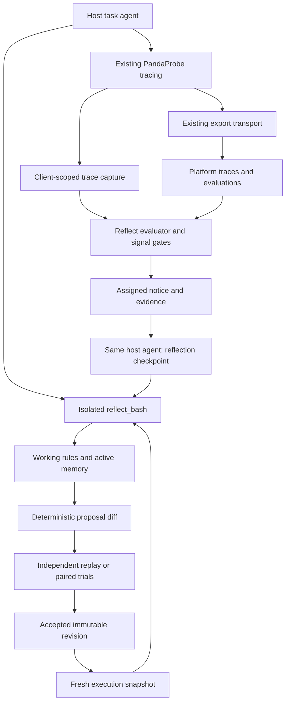

# PandaProbe Reflect for TypeScript — implementation and pre-release report

**Implementation baseline:** `e6edfbfa1bc70ba83f077e51ad5bd38e093c6827`

**Report date:** 2026-10-27

**Feature branch:** `feat/typescript-reflect`

**Python behavioral reference:** Python `pandaprobe` **0.6.0**, merged at
`5e4457171996eecd5b34e0779fb5678798f1eae2`

**Version state at this baseline:** TypeScript `src/version.ts` is **0.4.2**;
`package.json` is **0.4.0**. Neither identifies a newly published Reflect release.

**Scope:** TypeScript Reflect, native platform API, additive trace capture, native
framework integrations, examples, parity work, verification, Vercel agent tracing,
and the release preparation that accompanies them.

## 1. Purpose and how to use this report

This report records what was implemented, how it behaves, why its boundaries
exist, what changed during verification, and what the available evidence supports.
It follows the structure of
[python-reflect-technical-report.md](python-reflect-technical-report.md), with
TypeScript source locations and native runtime details. Its main audience is
future coding/documentation agents and maintainers who need durable context
without reconstructing the implementation conversation.

This is an implementation report, not a new architecture proposal or release
announcement. The user's instruction was to reproduce the released Python
behavior, allowing natural language/runtime/framework translations rather than
inventing new Reflect policy. The settled architecture was retained. Python
source, the existing TypeScript source version, and the TypeScript release
workflow are unchanged relative to the merged Python baseline.

The report was prepared from the committed TypeScript source, tests, guides,
[implementation plan and evidence log](typescript-reflect-plan.md), saved local
live reports, and retained verification logs. The user confirmed the examples and
tests worked after the follow-up fixes. No new provider/evaluation calls or suite
reruns were needed to write this report. The working tree was clean before this
document was added.

Evidence levels are deliberately separate:

- Source and tests establish implemented behavior and tested failure paths.
- Historical local test results identify their actual Node/OS/dependency baseline.
- Saved live artifacts establish the recorded result of a particular workload/run.
- Earlier read-only PandaProbe CLI investigation established the original Vercel
  trace shape; it was not a runtime dependency.
- User confirmation supplements those records, without turning them into a
  broad model-performance benchmark.
- Hosted CI, PR merge, version selection, and npm publication for this feature
  are not claimed as completed here.

For future work, read the relevant source at the target commit before relying on
this snapshot. The root plan contains both requirements and a chronological
history; later follow-ups supersede earlier diagnoses. In particular, the initial
Claude delivery-audit limitation was corrected, and Vercel tracing was expanded
after its model-only behavior was inspected. This report describes their final
implemented state at the baseline above.

## 2. Product capability delivered

PandaProbe's public stack is **Trace → Evaluate → Reflect**. Reflect implements
**Detect → Notify → Reflect → Validate**:

1. Observe an application-owned agent through existing PandaProbe tracing.
2. Collect trace references for one explicit application execution.
3. Obtain platform evaluations and detect configured failure/trajectory signals.
4. Present that evidence to the same host agent at a bounded reflection checkpoint.
5. Let the agent propose changes through an isolated rule filesystem.
6. Independently assess the changes through host replay or matched live trials.
7. Publish accepted immutable guidance for later executions to retrieve.

The mechanism changes context and execution infrastructure, not model weights.
It adds neither a model-serving system nor a package-owned repair model. Task
models, prompts, business tools, business state and independent verifiers remain
the host's responsibility.

Reflection completion, proposal creation, acceptance, retrieval and later task
success are different facts. A checkpoint can produce no change, an exact
duplicate, invalid guidance, a timeout, or a candidate that remains pending.
Accepted guidance has supporting evidence under tested conditions; acceptance
does not guarantee universal repair or future compliance.

### What changed from the experimental Harness direction

TypeScript adopts the already-settled Python Reflect design. It does not revive
the older experimental Harness architecture.

| Concern | Implemented TypeScript Reflect behavior |
| --- | --- |
| Who reflects | The developer's task agent, continued at an explicit checkpoint |
| Agent-facing memory interface | One supplied `reflect_bash` tool |
| Guidance retrieval | Agent-driven search/read of a virtual filesystem |
| Active memory | Bounded `context.md`, refreshed at native invocation checkpoints |
| Shared acceptance | Independent SDK validator using host-verified outcomes |
| Platform access | Native asynchronous `fetch` resources in `pandaprobe/api` |
| CLI dependency | None in Reflect; example argument parsing is separate |
| Conversation rewriting | Not implemented |
| Core delivery checker | None; examples retain their own observation audit |
| Default daily evaluation count cap | None; an explicit positive cap is optional |
| Legacy Harness support | No aliases, bridge package, or managed second agent |

The work ports the selected filesystem/active-memory ideas and operational
guarantees. It does not establish superiority over a separate repair agent or
reproduce the full CLM research mechanism or its reported results.

## 3. Distribution, activation, and dependency boundaries

Reflect ships inside the existing npm package, **`pandaprobe`**, through explicit
subpath exports:

```ts
import { Client } from "pandaprobe";
import { Reflect as ReflectRuntime } from "pandaprobe/reflect";
import { PlatformClient } from "pandaprobe/api";
```

There is no separate `pandaprobe-reflect` distribution. The TypeScript source
remains under `libraries/typescript/src/`; `index.ts` files define exports in
the role Python assigns to `__init__.py`.

Application installation uses optional peers rather than Python extras:

```sh
npm install pandaprobe @everruns/bashkit@0.19.0 fs-native-extensions@1.5.1
# Install the application's chosen framework/provider separately.
```

The package has **zero required runtime dependencies**. Bashkit and the lock
binding are optional peer dependencies, pinned to **0.19.0** and **1.5.1**
respectively. Framework/provider SDKs remain optional peers. Broad peer ranges
preserve older tracing-only installations; they are not a declaration that every
framework version supports Reflect.

Public imports do not create a workspace, start evaluations, invoke a model,
or activate framework adapters. Optional runtimes are checked when Reflect is
activated/used; a missing engine or lock binary produces installation guidance.
Native framework imports are lazy. The build emits ESM, CommonJS, declarations
and source maps, with shared chunks so subpath imports use the same initialized
client and asynchronous tracing context.

The base package declares **Node >=18**. The tested native framework fixture
declares **Node >=22**; framework and provider requirements can be stricter than
the base SDK. Reflect is a Node filesystem/native-binary feature, not a browser
or edge-worker implementation.

Development commands mirror Python's separate installation targets:

| Location / command | Meaning |
| --- | --- |
| `libraries/typescript: make install` | `pnpm install` for the current development manifest |
| `libraries/typescript: make install-reflect` | Explicit `pnpm add -D --save-exact @everruns/bashkit@0.19.0 fs-native-extensions@1.5.1` |
| Repository root: `make ts-install-reflect` | Delegates to the TypeScript target |
| `make install-<framework>` | Adds that framework/provider development dependencies |
| `make install-native-test` | Installs the separately locked `test/native` fixture |

Reflect's shell/lock packages are also development dependencies, because core
tests execute the actual runtimes. Thus the ordinary development install already
includes them, just as Python's development extra includes its Reflect test
requirements. `install-reflect` is an explicit setup recipe, not a switch that
selectively adds source files to the distribution.

**Current checkout distinction:** at the report baseline, the committed root
development manifest also contains packages installed during live verification,
including AI SDK 7, LangChain and DeepAgents. It is not a tooling-only manifest.
Installed `ai@7.0.154` and `@langchain/openai@1.7.1` declare Node >=22;
`langchain@1.5.20` and `@langchain/core@1.3.0` declare Node >=20. This does not
add required dependencies for npm consumers, but a fresh development install
must be distinguished from the earlier minimal-install verification. Do not use
the older documentation shorthand “all dev dependencies support Node 18” as a
claim about this final manifest.

Sources: [package metadata](libraries/typescript/package.json),
[Makefile](libraries/typescript/Makefile),
[build configuration](libraries/typescript/tsup.config.ts),
[Reflect exports](libraries/typescript/src/reflect/index.ts),
[package verification](libraries/typescript/scripts/verify-package.mjs).

## 4. Module ownership and architecture



The export transport continues to export traces. It does not own evaluation or
reflection policy. The reusable platform client has a separate request/cancellation
lifecycle. Reflect orchestrates those existing boundaries explicitly.

| Component | Responsibility |
| --- | --- |
| [api/client.ts](libraries/typescript/src/api/client.ts) | HTTP identity, safe reads, deadlines, cancellation and request ownership |
| [api/resources.ts](libraries/typescript/src/api/resources.ts) | Trace discovery/visibility and evaluation creation/polling/scores |
| [api/models.ts](libraries/typescript/src/api/models.ts), [errors.ts](libraries/typescript/src/api/errors.ts) | Runtime API decoding, typed data, numeric conversion and error distinctions |
| [tracing/capture.ts](libraries/typescript/src/tracing/capture.ts) | Observation of existing trace submissions |
| [reflect/config.ts](libraries/typescript/src/reflect/config.ts) | Policy defaults, environment workspace override and runtime validation |
| [reflect/models.ts](libraries/typescript/src/reflect/models.ts) | Rules, notices, proposals, outcomes, trials and reports |
| [reflect/workspace.ts](libraries/typescript/src/reflect/workspace.ts) | Durable authority, atomic writes, revisions, diffs and publication |
| [reflect/locks.ts](libraries/typescript/src/reflect/locks.ts) | Pinned native advisory-lock binding |
| [reflect/serialization.ts](libraries/typescript/src/reflect/serialization.ts) | Reproducible JSON and Python-compatible hash serialization paths |
| [reflect/shell.ts](libraries/typescript/src/reflect/shell.ts) | Embedded Bash, read-only evidence mounts, budgets and rollback |
| [reflect/execution.ts](libraries/typescript/src/reflect/execution.ts) | Pinned working view, memory, checkpointing, attribution and sealing |
| [reflect/evaluation.ts](libraries/typescript/src/reflect/evaluation.ts) | Durable dispatch claims, evaluation scheduling, usage and evidence |
| [reflect/signals.ts](libraries/typescript/src/reflect/signals.ts) | Threshold/regression/stall conditions, deduplication and cooldown |
| [reflect/runtime.ts](libraries/typescript/src/reflect/runtime.ts) | Host orchestration, explicit waits, continuation and shutdown |
| [reflect/async.ts](libraries/typescript/src/reflect/async.ts) | Promise task records, bounded waits and evaluation semaphore |
| [reflect/validation.ts](libraries/typescript/src/reflect/validation.ts) | Independent replay/trial assessment and publication |
| [reflect/integrations.ts](libraries/typescript/src/reflect/integrations.ts), [adapters](libraries/typescript/src/reflect/adapters) | Lazy native tools, permissions, memory and continuation |
| [integrations/vercel-ai](libraries/typescript/src/integrations/vercel-ai) | Native agent/step/tool tracing, separate from Reflect policy |
| [examples/reflect/_support](libraries/typescript/examples/reflect/_support) | Shared business workloads, runners, delivery audit and reporting; excluded from runtime package |

The additional helper files are organizational/native implementation boundaries.
They do not represent extra framework policy. In particular, `async.ts`,
`serialization.ts` and `locks.ts` isolate mechanisms that Python obtains through
its standard/runtime libraries or keeps in larger modules.

## 5. Public API and host integration

The principal runtime exports from `pandaprobe/reflect` are:

```text
Reflect, ReflectConfig, Execution, Invocation
Rule, Outcome, ReplayCase, ReplayRequest
```

Associated exported TypeScript types include `ReflectInit`, `ReflectOptions`,
`ResolvedReflectConfig`, `ExecutionOptions`, `Phase`, `RuleProposal`,
`ProposalOutcome`, `EvaluationOutcome`, `ExecutionReport`, `ValidationVerdict`,
`TrialCase`, `TrialArm`, `Replay`, `Agent`, `AgentOptions`, `Framework` and
`NativeAgent`. An interface/type export is not a JavaScript constructor.

TypeScript method/configuration names use camelCase. Persisted records and
wire-facing fields retain the Python contract's snake_case, such as
`execution_id`, `base_revision`, `run_ids` and `candidate_ids`. Do not
mechanically rename stored fields while updating examples or documentation.

A native LangChain integration looks like:

```ts
import { Client } from "pandaprobe";
import { Reflect as ReflectRuntime } from "pandaprobe/reflect";
import { LangChainCallbackHandler } from "pandaprobe/integrations/langchain";
import { createAgent } from "langchain";

const client = new Client(); // normal PandaProbe environment/configuration
const reflect = new ReflectRuntime(client);
try {
  const agent = await reflect.agent(createAgent, {
    framework: "langchain",
    options: { model: existingModel, tools: domainTools },
    invokeOptions: {
      callbacks: [new LangChainCallbackHandler({ client })],
    },
  });
  const result = await reflect.run(agent, "Do the task", {
    sessionId: "customer-123",
    executionId: "turn-42",
  });
  const report = reflect.report("turn-42");
  // Use result and report in the host application.
} finally {
  await reflect.close();
  await client.shutdown();
}
```

`existingModel` and `domainTools` are application-owned objects. Existing
callbacks can be retained alongside the PandaProbe callback. Reflect does not
infer missing trace evidence from a session name or automatically enable tracing.
Without an independent verifier, this setup can generate proposals but cannot
automatically establish acceptance.

| Method/interface | Actual responsibility |
| --- | --- |
| `new Reflect(client?, {config?, api?, replay?, cases?})` | Reuses explicit/initialized client, creates its identity workspace; replay and cases must be supplied together |
| `await agent(factory, {framework, options?, invokeOptions?})` | Adds the supplied tool and supported native context/permission integration |
| `await tool(framework?)` | Returns the single Reflect tool in a native format; generic form is a command callback |
| `bash(command)` | Routes to this runtime's current execution |
| `run(agent, input, {sessionId, executionId?, completed?, signal?, invokeOptions?})` | Task plus bounded evaluation/reflection; returns the task's original result |
| `execution(options, callback)` | Explicit boundary for custom agents and complete stream consumption |
| `submitTraces(ids, options)` | Registers externally completed trace evidence |
| `waitExport({timeout?})` | Flushes existing trace export only |
| `settleEvaluation(id, {timeout?, signal?})` | Waits/resumes evaluation; caller deadline can return pending |
| `resumeEvaluations()` | Returns promises for eligible persisted unfinished evaluations |
| `continueReflection(id, callback, options?)` | Explicit host continuation, including for late feedback |
| `settleReflection(id, options?)` | Waits for an already scheduled checkpoint |
| `validate(id, {cases, replay, signal?})` | Schedules independent paired replay |
| `settleValidation({timeout?, signal?})` | Waits separately for scheduled validations; returns whether waiting completed |
| `trialExecution(id, {arm, sessionId?, signal?}, callback)` | Opens a fresh explicit control/candidate view |
| `validator.recordTrial(id, case)` | Records matched host-verified trial evidence |
| `report(id)`, `proposals()` | Reads persisted lifecycle/evidence state |
| `close()` | Cancels owned work and closes owned platform requests; does not shut down the host's SDK client |

The generic callback must return a Promise and accept an `Invocation`. Its
properties are `input`, `execution`, `phase`, `previousResult`, `feedback`,
`signal` and the current `instructions` getter. Generic hosts must actually
supply the instructions/tool and enforce reflection restrictions themselves.
Arbitrary precompiled graphs cannot acquire new tool nodes merely through a cast.

Promise-returning construction, explicit `try/finally`, callback scopes and
`AbortSignal` replace Python's coroutine/context-manager mechanics. They do not
change who owns proposal generation, business verification or publication.

## 6. Execution and reflection lifecycle

### 6.1 Identity and working view

An execution ID identifies one invocation; a session ID groups related work.
Creating an execution pins the accepted revision and opens a separate shell.
Ordinary tasks see accepted guidance. Same-session active memory is reused only
when its recorded revision matches the execution's pinned base.

Checkpoints store working Markdown files, context, active-memory hash/unvalidated
flag, base revision, role, task/processing status, candidate IDs, proposal outcome,
usage counters and phase trace IDs. A reflection continuation restores these
working files and counters; it does not reset an already consumed output budget.
Execution IDs cannot be reused through a new ordinary execution when their
snapshot already exists; continuation is an explicit operation.

### 6.2 Task completion

The execution callback must encompass actual work. For streaming hosts this means
consuming the stream to completion or cancellation inside the boundary.

On exit, the task boundary records operational completion/failure, collects
captured task trace IDs, seals the entire working-rule diff, schedules registered
validation for a new candidate, submits task evidence and closes its shell.
Task-time rule changes are proposals too; authoring is not limited to failure
checkpoints.

`completed: true` means the application evidence is final for signal gating,
not that the business objective succeeded. A terminal failed task can be evaluated.
If task invocation throws, the original exception propagates and `run()` does
not manufacture a successful result or automatically continue reflection.
Ordinary settlement/cleanup failures are isolated from successful task results;
explicit caller cancellation still propagates.

### 6.3 Evidence and checkpoint

After normal task return, `run()` waits on the evaluation/notice path. If an
assigned notice exists, it claims reflection durably, restores the execution,
mounts external evidence and continues the same host agent.

The feedback asks the agent to compare fallible judge explanations with actual
execution evidence, inspect existing rules, make at most one coherent improvement
or maintenance change set, or leave the files unchanged. It tells the agent not
to repeat business actions or poll for validation. Native adapters expose only
Reflect administration during this phase, within command/turn/time limits.

The returned explanation is retained as agent rationale. The SDK separately
records its `ProposalOutcome` and reason. Reflection timeout, error or no-proposal
does not replace the successful original task answer. The outer persisted
`reflection.status = "completed"` means checkpoint processing ended; its nested
outcome can still be failed, cancelled or timed out.

### 6.4 Scheduling, recovery, and cancellation

Evaluation, reflection, validation and outstanding host promises are tracked
separately. Registered replay/cases schedule validation automatically, but the
original task does not wait for replay while holding resources replay may need.
The application settles validation after releasing those resources.

Durable reflection claims prevent duplicate administration across instances or
restarts. A previously claimed checkpoint without a terminal outcome requires
review rather than automatic re-entry into potentially side-effecting host code.
Late evaluation cannot resurrect an agent; the host must supply a continuation.

Settlement deadlines bound the caller's wait without necessarily cancelling
shared work. For example, a timed-out `settleReflection()` can report that the
checkpoint is still running. `callHost()` combines the runtime/caller abort
signals, bounds waiting, signals cancellation and observes eventual errors from
remaining promises.

`close()` aborts owned work, closes active shells and waits up to
`shutdownTimeout`. It closes a platform client it constructed, but leaves an
injected API client and the host's SDK client under host ownership. Closed shells
cannot be used by late host work to keep changing guidance.

Cancellation is cooperative in JavaScript. The runtime cannot kill arbitrary
uncooperative host computation, interrupt a synchronously blocked event loop, or
undo a provider request already accepted remotely.

## 7. Preserving tracing: what TraceCapture adds

Existing wrappers/framework adapters still create traces and the existing
transport still exports them. The additive
[TraceCapture](libraries/typescript/src/tracing/capture.ts) observes submissions
at `Client.logTrace()`, through `Client.captureTraces()`.

Trace capture:

- Creates no traces and does not patch frameworks, poll storage or evaluate work.
- Uses a client-owned `AsyncLocalStorage` scope.
- Collects distinct trace IDs up to a bound and exposes overflow.
- Adds metadata/session attribution to a copied export payload, without changing
  the original `TraceData` for that purpose.
- Restores outer scopes after nested callbacks return.
- Keeps inherited phase attribution on late descendant submissions, while not
  adding their IDs to an already closed capture boundary.
- Isolates synchronous and asynchronous submission-observer failures from export.

Capture proves submission to the SDK transport, not platform persistence.
`waitExport()`, trace visibility and evaluation are distinct operations.

Reflect uses another, instance-owned `AsyncLocalStorage` for tool dispatch;
there is no process-global “last active Reflect” router. Native Claude MCP tools
also bind directly to their execution because callbacks can cross asynchronous
resource boundaries.

Captured phase metadata is:

```json
{
  "pandaprobe.reflect": {
    "role": "task",
    "execution_id": "turn-42",
    "task_session_id": "customer-123"
  }
}
```

Roles are `task`, `reflection` and `validation`. Internal work uses trace session
attribution such as `reflect:reflection:<execution-id>`. Evaluation excludes
internal-role evidence to prevent recursive evaluation/reflection, while retaining
its observability and any available usage/cost telemetry.

The original tracing regression suite remained part of base verification. The
later Vercel work is an explicit addition to its framework integration, described
in section 13; it does not move framework instrumentation into Reflect core.

## 8. Native platform API and safe evaluation creation

`PlatformClient` is independently useful without constructing Reflect. It
accepts an SDK client, or explicit resolved configuration through its options,
and otherwise uses normal SDK initialization/configuration. Passing both client
and explicit configuration is rejected. Credentials/project identity are reused;
there is no second authentication system.

Requests use native `fetch`, `X-API-Key` and `X-Project-Name`. Redirects are not
followed. Endpoints must be HTTP(S), without embedded credentials, query or
fragment. Resource paths cannot be arbitrary absolute URLs. Closing the platform
client aborts its active requests.

| Resource operation | Relative endpoint |
| --- | --- |
| `traces.list()`, `traces.iterate()` | `GET traces`, with session/status/pagination support |
| `traces.get()`, `traces.waitVisible()` | `GET traces/{trace_id}` |
| `evaluations.metrics()` | `GET evaluations/trace-metrics` |
| `evaluations.create()` | `POST evaluations/trace-runs/batch` |
| `evaluations.get()` | `GET evaluations/trace-runs/{run_id}` |
| `evaluations.scores()` | `GET evaluations/trace-runs/{run_id}/scores` |
| `evaluations.wait()` | Polls that run, then checks the expected score matrix |

Runtime decoders validate identifiers, known status/field contracts and retrieved
identity, while allowing additive server fields. Python-generated differential
fixtures cover numeric-score grammar, integer coercion and missing-versus-null
semantics; the port is not based only on TypeScript compile-time interfaces.

There is no shell-out to PandaProbe's CLI, CLI authentication dependency, backend
implementation import, monitor CRUD, or scheduled-monitor controller.

### Read/retry behavior

The platform client defaults to a **30-second operation budget** and **three GET
attempts**. Safe reads retry selected transport/status failures within a
monotonic deadline. Backoff has jitter; `Retry-After` accepts seconds or an HTTP
date and is bounded. Cancellation is not retried.

Distinct errors represent authentication, not found, rate limit, transport,
deadline, invalid response, failed evaluation, insufficient evidence and uncertain
creation. Callers can distinguish infrastructure failure from a measured low score.

Trace visibility tolerates initial 404s and waits for terminal `COMPLETED` or
`ERROR`. Evaluation polling uses one known run ID and fails on terminal failed
or cancelled runs. A completed run alone is insufficient: every expected
trace/metric pair needs one successful finite numeric score from that same run.
Duplicate, missing, unusable or wrong-run evidence does not become success.
Reflect additionally requires normalized [0,1] values for signal decisions.

### Creation uncertainty and durability

The adopted backend contract has no evaluation-create idempotency key. Creation
therefore uses **one POST attempt**:

1. Persist a `creating` claim for execution, stage, trace IDs and ordered metrics.
2. Increment the creation-attempt counter before dispatch.
3. Send the POST once.
4. Persist a returned run ID synchronously before another asynchronous wait.
5. Poll/resume that same run on subsequent waits or after restart.

Transport ambiguity, server failures that may follow creation, malformed success
responses, cancellation or a crash between dispatch and run-ID persistence can
leave `creation_unknown` or a claim with no recoverable run ID. The runtime
refuses a replacement create. This avoids automatic duplicate potentially
billable evaluations; it cannot discover an unknown server-generated ID or promise
exactly-once server execution. Operator reconciliation or future backend support
would be required.

Dispatch hashes preserve Python's **ordered metric array**, not a newly sorted
semantic set. Reordered equivalent threshold insertion order can therefore yield
different dispatch claims. The port deliberately did not add fallback
execution/stage deduplication beyond the source contract.

The checked-in
[platform contract fixture](libraries/typescript/test/fixtures/platform_contract.json)
and [API tests](libraries/typescript/test/api.test.ts) pin the relevant wire shapes.
[update-platform-contract.py](libraries/typescript/scripts/update-platform-contract.py)
regenerates them from an independently exported OpenAPI document. Python is a
development fixture tool here, not an SDK runtime dependency.

## 9. Detection, diagnostics, budgets, and evidence

### 9.1 Evaluator scheduling

Submission normalizes, deduplicates and sorts trace UUIDs, requires execution and
session identity, and persists the requested evidence/policy. Reusing an execution
ID with different evidence or policy is invalid. Trace ownership prevents the
same evidence from being resubmitted under a new execution to generate additional
evaluation work.

In-flight work is single-flight per execution within a runtime. Durable workspace
claims coordinate creation across instances. Empty evidence, the trace-count
limit and deterministic sampling are checked before new evaluation work.
Sampling derives from execution identity, not a fresh random choice on each retry.

A per-runtime semaphore bounds evaluation orchestration. Persisted traces are
loaded and reflection/validation roles excluded. Primary evaluation uses the
configured threshold metrics; the minimum score over eligible traces represents
each metric for the application boundary.

### 9.2 Signal semantics

The signal gate requires all configured metrics with finite normalized values.
It stores bounded per-session history and per-signature cooldowns. Seeing the
same execution again does not manufacture a trajectory.

Conditions are applied in order for each metric:

1. A completed execution strictly below threshold produces `below_threshold`.
2. Otherwise, a drop at least `regressionDrop` from the previous score, while
   still below threshold, produces `regression`.
3. Otherwise, enough below-threshold history with range smaller than
   `minimumProgress` produces `stalled`.

Cooldown removes recently emitted signatures. These are ordered alternatives:
a completed low score is not simultaneously classified as all three.

**Equality is not failure.** A score of 0.8 at threshold 0.8 does not trigger a
threshold notice. A deterministic business verifier can disagree with a platform
judge; the SDK does not fabricate a notice to force the example onward.

### 9.3 Diagnostics and evidence

A detected notice can trigger diagnostic metrics, by default tool correctness and
argument correctness. Diagnostic failure or budget exhaustion does not erase the
primary result/notice.

Evidence prioritizes primary/diagnostic results before potentially large raw
traces, clips to the configured byte allowance with explicit truncation, and
preserves trace/run IDs for later investigation. A notice carries identity,
scores, reasons, signatures and time. Judge explanations are external, fallible
evidence, not authoritative business truth or sufficient proof for acceptance.

### 9.4 Daily usage accounting

`evaluationMaxRuns` defaults to **null**, meaning no daily count cap. There is no
default 100-evaluation quota, and zero is not an unlimited sentinel.

An optional positive integer limits creation attempts per UTC day within the
identity workspace across instances/restarts. Primary detection and diagnostics
each consume an attempt. Failed/uncertain creates count; polling an existing run
does not. Counting continues while uncapped, so a cap enabled later includes that
day's earlier attempts.

At the cap, new detection is skipped with usage/reset information; diagnostic
exhaustion retains primary evidence. Task execution, accepted guidance and polling
already-created evaluations continue. Midnight UTC permits new requests again,
but does not automatically retry a previously skipped execution.

The counter is shared; each runtime applies its configured cap. There is no
additional persisted cross-instance cap-consistency requirement. Applications
sharing a workspace should choose consistent settings. This is local attempt
accounting, not a monetary budget, provider limit or backend quota. No extra
`evaluationUsage()` public API or `evaluation_usage` report field was added.

Sources: [evaluation.ts](libraries/typescript/src/reflect/evaluation.ts),
[signals.ts](libraries/typescript/src/reflect/signals.ts),
[evaluation tests](libraries/typescript/test/reflect/evaluation.test.ts).

## 10. Rule filesystem, durable storage, and active memory

### 10.1 General shell interface

`reflect_bash(command: string): Promise<string>` is the sole agent-facing Reflect
tool. It uses the real embedded Bashkit **0.19.0** interpreter and virtual
filesystem. It does not launch the host's Bash.

Search/read/edit operations include grep, find, cat, sed, awk, pipes, redirection,
loops, heredocs, mkdir, moves and deletions. The engine is constructed without host
mounts, with only its explicit Reflect environment marker, and with embedded
Python/SQLite disabled. The supplied filesystem does not expose host credentials,
arbitrary external executables or a network facility.

| Agent-visible path | Purpose and access |
| --- | --- |
| `/rules/**/*.md` | Read/write working rule snapshot |
| `/context.md` | Read/write bounded active notes |
| `/inbox/notice.json` | Read-only assigned notice |
| `/inbox/evidence.txt` | Read-only diagnostic evidence |
| `/decisions/status.json` | Read-only recent proposal/decision summaries |

These are virtual paths, not directories at the root of the developer's machine.
The authoritative host workspace is never mounted into the tool. Scratch files
and interpreter state may exist during an invocation, but durable checkpointing
focuses on rule Markdown, active memory and bookkeeping rather than a complete
operating-system image.

Each execution owns an interpreter and a serialized Promise queue. Input bytes,
engine commands/iterations/memory/time, per-response bytes and cumulative output
are bounded. Reflection adds a default eight-tool-call allowance relative to the
existing command count. Guard/error replies use the same output allowance, and
restoration preserves usage counters.

Replies include stdout/stderr, exit code, context size and explicit truncation
information. Closed or exhausted boundaries can return empty text; that alone is
not evidence of a broken tool.

The shell snapshots before a call. Thrown interpreter failures, caller
cancellation and invalid filesystem exports restore the prior snapshot; read-only
mounts are re-established after restore. **Returned** native error results and
nonzero exit codes, including 124, retain otherwise valid edits, matching Python's
Bashkit behavior. Do not reintroduce an unconditional “nonzero means rollback”
policy while refactoring.

File export bounds traversal depth/entry count, rejects nonregular files and
symlinks, checks relative Markdown names, and enforces file/corpus limits.
Intermediate edits need not form a complete semantic rule; `Rule` validation
occurs at sealing.

Isolation applies to the supplied tool. Unrestricted host tools and trusted
developer code remain able to access their own filesystem; Reflect is not an OS
security boundary against the host application.

### 10.2 Rule schema and deterministic identity

A rule is Markdown with a title, applicability and guidance:

```markdown
# Refund merchandise only
Applies to: authorized standard-return refund settlement
Use merchandise paid; exclude nonrefundable outbound shipping.
```

`Rule` validates a restricted relative `.md` path, normalizes line endings and
outer whitespace, and ensures one trailing newline. It requires a `# ` title,
an `Applies to: ...` line, at least three lines and no NUL. Its version is SHA-256
of normalized UTF-8 text. Parent directory determines scope; root files use
`global`. Applicability is descriptive text, not an executable routing predicate.

Sealing compares the **whole** working snapshot with its pinned accepted base.
New/changed paths contain rule records; removals are null. A move is deletion plus
addition. No diff produces `no_proposal`. Identical normalized guidance under
another filename and repeated exact base/change fingerprints are deduplicated.
There is no semantic contradiction resolver or embedding-based duplicate search.

`serialization.ts` deliberately separates sorted compact Unicode JSON from
Python's spaced/ASCII JSON path used for other identities. Fixtures cover rule
normalization, manifests, revisions, proposals and replay hashes. A generic
`JSON.stringify()` replacement is not an equivalent implementation.

### 10.3 Durable workspace authority

Default host layout:

```text
.pandaprobe/reflect/<identity-namespace>/
  .lock
  state.json
  revisions/<revision>/manifest.json
  revisions/<revision>/rules/**/*.md
  executions/<sha256(execution-id)>.json
  evidence/<notice-id>.txt
  events/<event-id>.json
```

The namespace is the first 24 hex characters of SHA-256 over endpoint without
trailing slash, project name and API key, separated by newlines. Plaintext
credentials are not used as the directory name. Credential rotation changes the
partition. This is local identity separation, not authentication against a host
administrator.

Schema-1 `state.json` owns accepted head, proposals/decisions, evaluations,
creation accounting, trial evidence, signals/notices, execution requests,
trace ownership and session memory. Accepted files are located by following
`state.json.head` to its immutable revision.

Workspace transactions are synchronous under real OS advisory locks, with a
bounded acquisition wait. They reject asynchronous transaction callbacks.
Temporary writes use exclusive creation, restrictive file mode, fsync and atomic
rename; directory fsync is used on non-Windows platforms. A complete immutable
revision is written before publishing the new head.

Existing revisions are read back and checked against manifest/content hashes.
Invalid revision names, corrupt state, bad checksums and rule link escapes are
refused. Missing state beside nonempty revision manifests does not silently
reinitialize authority. Missing state with only an empty revision does reinitialize,
matching Python; no extra `.initialized` marker is required.

Accepted publication checks the proposal base against current head under the
workspace lock. A stale candidate cannot overwrite newer accepted guidance.
Events and execution snapshots are separate records, not one multi-file database
transaction. Crashes can leave unreferenced revisions; they must not leave a
partially published accepted head.

The pinned `fs-native-extensions@1.5.1` N-API binary is loaded directly. Its
transitive JavaScript resolver uses a Node 20-only array API; direct loading
preserves Node 18 without global polyfills or weaker PID-file locks. Upgrading
this binding requires rechecking binary paths, lock semantics and package tests.

Rule count/size limits do not prune revision, event or evidence history.
Retention, permissions, backups and disk monitoring remain operational concerns.
Local filesystem locks/atomic rename are assumed; object storage or distributed
mounts are not interchangeable workspace backends.

### 10.4 Active memory and retrieval

`Execution.instructions()` supplies a fixed preamble plus one
`<reflect_active_memory>` block when `context.md` is nonempty. Native adapters
replace/refresh that block at their supported checkpoints. The SDK does not
automatically select, rank or inject all accepted rules.

Agents retrieve guidance with ordinary filesystem commands. A stored rule is
available for retrieval; storage does not establish consumption.

Memory-only changes can carry into the same session at the same accepted revision.
Memory associated with candidate rule changes is not propagated into a fresh
ordinary view. Validation starts with fresh local memory and assigned rules.
Active notes are marked unvalidated; they are not shared accepted guidance.
An authoring conversation may still contain candidate text and is not a clean
control.

No adapter compresses or rewrites the whole host conversation. Byte/count budgets
bound the supplied tool and stored active corpus, not accumulated framework
history, unrelated tool schemas, total tokenizer context, provider billing or
audit disk growth.

JavaScript cannot represent every Python arbitrary integer, distinguish every
integer/float spelling, or reproduce all numeric JSON spellings. Representative
hashes match differential fixtures; universal cross-language numeric canonicalization
and concurrent mixed-language locking are not promised. Use separate writable
Python/TypeScript workspaces and reproducible JSON inputs; the examples use safe
integer cents for money.

Sources: [workspace.ts](libraries/typescript/src/reflect/workspace.ts),
[shell.ts](libraries/typescript/src/reflect/shell.ts),
[execution.ts](libraries/typescript/src/reflect/execution.ts),
[workspace tests](libraries/typescript/test/reflect/workspace.test.ts),
[shell tests](libraries/typescript/test/reflect/shell.test.ts).

## 11. Proposal and outcome records

TypeScript readonly types are backed by runtime construction/decoding checks.
Record fields are generally shallow-frozen. Like Python's frozen records,
this does not imply deep immutability of nested containers or create a security
boundary against trusted host code. `Outcome` and `ReplayCase` preserve their
input references as their Python dataclass counterparts do.

| Record | Key information |
| --- | --- |
| `Rule` | Relative path, normalized text, derived version/scope/applicability |
| `RuleProposal` | Base revision, changes, fingerprint, authoring identity, evidence, rationale, status and decision |
| `FailureNotice` | Assigned execution/session/traces, normalized scores, reasons, signatures and time |
| `EvaluationOutcome` | Status, known run IDs, scores, notice and reason |
| `ProposalOutcome` | Generation status, optional proposal, SDK reason and separate agent rationale |
| `ValidationVerdict` | Proposal, accepted/rejected/pending, reason, replay/trial mode and cases |
| `Outcome` | Host-verifier scores, boolean/null success and independent evidence |
| `TrialArm` / `TrialCase` | Execution/assignment, outcomes, input/base identity and protection |
| `ExecutionReport` | Operational task status, task trace IDs, evaluation, reflection and related proposals |

`FailureNotice` is a runtime record defined in `models.ts` and nested within
evaluation outcomes; it is not listed as a top-level public export in the current
Reflect barrel. Internal helpers and the `Workspace`/`Validator` implementation
classes should not be advertised as new supported subpath exports.

The separate status vocabularies are:

```text
EvaluationOutcome:
  evaluated | skipped | pending | insufficient | failed | creation_unknown | cancelled

ProposalOutcome:
  proposed | duplicate | no_proposal | invalid | conflict | timed_out | failed | cancelled

RuleProposal:
  candidate | pending | accepted | rejected

ValidationVerdict:
  accepted | rejected | pending
```

Record tests cover defaults, rejected extra/null/wrong-type fields and nested
decoding. API response decoding is a different boundary and intentionally permits
additive server fields.

A proposal ID, completed task or completed checkpoint is not a
`repair_success` field. Model explanations remain rationale. Core reports
contain no delivery receipts or automatic proof that a rule caused an outcome.

## 12. Independent acceptance algorithm

The agent edits working files; it cannot publish or decide its proposal through
`reflect_bash`. The independent validator owns shared publication. Trusted host
code supplies verifiers and has ordinary library/OS authority; this is separation
from the proposing model, not protection against a malicious host.

### 12.1 Replay collection

`ReplayCase` supplies a stable ID, reproducible JSON input and protected flag.
`ReplayRequest` supplies the case, fresh execution, control/candidate arm and
abort signal. Its `run(agent)` invokes the host in validation phase without
recursive task evaluation.

Each arm pins the proposal's original base and starts with fresh session,
execution and local memory. Control receives the baseline rules and no candidate
assignment; candidate receives baseline plus exactly that proposal. Arm order
alternates deterministically from the case-ID hash.

The host must reset business state and provide independent expected outcomes.
Recorded traces are not enough to reconstruct an arbitrary application
environment automatically.

Replay returns an actual `Outcome` instance. Scores require nonempty names and
finite numeric values in [0,1]; booleans and numeric strings do not qualify.
Success is a real boolean or null at construction and must be explicit for
assessment. Inputs/evidence must be reproducible JSON without nonfinite values
or cycles. The validator records input hash, base, arm IDs, assignment, scores,
success and evidence, and rejects replay that altered its assigned rule snapshot.

### 12.2 Assessment, in order

The implemented [validator](libraries/typescript/src/reflect/validation.ts)
follows Python's ordered checks:

1. Require the minimum distinct paired cases, default three.
2. Require at least one protected case.
3. Require the correct base, both arms, globally distinct execution IDs, all
   configured metrics, valid scores and explicit boolean success.
4. Require no control candidate assignment, exactly this proposal for candidate,
   and matching paired metric sets.
5. Require protected control success; otherwise evidence is insufficient.
6. Reject when a successful control becomes an unsuccessful candidate.
7. Reject any per-case metric regression beyond tolerance.
8. Average metric deltas over non-protected comparisons. Accept when the mean
   reaches `validationMinImprovement`.
9. Otherwise, accept a strict reduction in total UTF-8 guidance bytes if the
   preceding outcome/regression checks passed, with an explicit non-inferiority
   maintenance reason and no behavioral-improvement claim.
10. Otherwise retain pending status for insufficient measured improvement.

This does not require every control to fail, nor does it replace actual paired
outcomes with the discovery task's score. Case count, protected coverage, outcome
preservation and metric regression checks are independent conditions.

### 12.3 Publication, live trials, and interruption

Publishing accepted guidance is atomic under workspace authority and requires
the original accepted head. If accepted guidance changed, the verdict becomes
pending with a rebase/revalidate reason. Decided proposals are not silently
reopened.

`trialExecution()` provides explicit fresh arms for host-controlled live trials.
`validator.recordTrial()` validates matched evidence, stores it durably and
applies the same assessment algorithm. An identical repeated record is idempotent;
an existing case cannot be replaced with different evidence. This is not
unpaired observational success being promoted as an experiment.

Replay exceptions, timeouts and interruption preserve partial rows and produce
pending evidence rather than a false rejection or acceptance. Caller/runtime
cancellation remains observable. A pending proposal stays outside ordinary fresh
accepted views; it needs more valid evidence or a new/rebased proposal.

There is **no rule-text delivery gate** in this algorithm. It checks assignment,
frozen snapshots and independently verified outcomes, not whether every line of
a file appeared in a prompt. Section 15 explains the separate example audit.

## 13. Native framework adapters

The TypeScript scope covers its six existing framework surfaces plus a generic
asynchronous callback. Python's Google ADK and CrewAI adapters were not ported
within this settled scope. Vercel AI is a TypeScript-specific addition using the
same Reflect lifecycle and example workload.

| Framework | Native factory/surface | Principal Reflect boundary |
| --- | --- | --- |
| LangChain | `createAgent` | Model/tool middleware, native message state |
| LangGraph | `createReactAgent` | Prompt/model binding and guarded ToolNode execution |
| DeepAgents | `createDeepAgent` | LangChain middleware, native checkpoint state and tools |
| OpenAI Agents | `Agent` / native `run` | Per-invocation clone, dynamic instructions, native tool schemas |
| Claude Agent SDK | Wrapped `query` | Execution-bound SDK MCP server, query permissions and session continuation |
| Vercel AI | `ToolLoopAgent` | Per-invocation construction, `prepareCall`/`prepareStep`, native tools |
| Generic | Async `Invocation` callback | Host supplies actual model/tool integration and phase enforcement |

Adapters are in [reflect/adapters](libraries/typescript/src/reflect/adapters).
They preserve the host's model and tracing setup. Tool names/schemas are adapted
to actual native SDK APIs rather than replacing those APIs with a toy loop.
Supplying a second `reflect_bash` to `reflect.agent()` is rejected where the
adapter constructs the supplied tool.

### Framework-specific boundaries

**LangChain and DeepAgents.** Native `createMiddleware` refreshes the active
memory message at model calls and filters reflection tools to `reflect_bash`.
The tool-call wrapper independently refuses business-tool execution during
reflection. Existing middleware/callbacks are retained. Task-time DeepAgents
backend/subagents remain native; the examples do not disable them merely to make
the demonstration easier.

**LangGraph.** The JavaScript ToolNode lacks Python's corresponding asynchronous
tool-call hook. The port guards the actual native tool `invoke` path and binds
only allowed tools on the reflection model. It composes the host's prompt with
current memory. Custom models without `bindTools` or custom state without a
messages array require an explicit `Invocation` integration.

For all three LangChain-family adapters, reflection queries checkpoint state.
If native history exists, only new feedback/memory is supplied. If it is absent,
the completed result supplies continuation history. This prevents replaying
ID-less tool replies alongside deduplicated assistant messages. Validation gets
a fresh thread ID; reflection recursion is bounded. Native streaming is consumed
within the execution boundary.

**OpenAI Agents.** The task agent is cloned per invocation. Dynamic instructions
compose host instructions with current memory. Reflection removes task tools,
handoffs and external MCP servers, retaining only Reflect. With a native session,
continuation supplies new feedback only; without one it uses completed result
history. Validation rejects persistent session/conversation/previous-response
options. Streams are consumed and their completion/error checked.

The examples use JavaScript `MemorySession` where Python uses an in-memory
`SQLiteSession`. This is a native conversation-store translation, not a new
Reflect memory policy.

**Claude Agent SDK.** The supplied tool lives in the
`pandaprobe_reflect` SDK MCP server as
`mcp__pandaprobe_reflect__reflect_bash`. Its callback is bound to the specific
execution rather than relying only on ambient context. String and preset system
prompts preserve the host's content and append current Reflect instructions.

Reflection resumes the completed task's native session, exposes no built-in tools,
restricts MCP servers/allowed tools to Reflect, enables strict MCP configuration
and bounds turns. Validation removes session/resume/continue/fork settings.
Structured error results and missing terminal results are treated as failures;
provider/subtype details are preserved. Query/server cleanup and abort propagation
are explicit.

The removed TS-only `canUseTool` wrapper was redundant: bare allowed-tool entries
approved Reflect before that callback, producing the native shadowing warning.
The final implementation follows Python's restricted tool/server surface and
does not add that wrapper. Existing host callbacks/hooks remain host code.
The native Claude SDK can use its own runtime machinery; this does not make
PandaProbe CLI a Reflect dependency.

**Vercel AI.** Reflect constructs a native ToolLoopAgent per invocation, preserves
host preparation hooks and composes memory through `prepareCall`/`prepareStep`.
Reflection enforces the supplied tool/active-tool set and bounded step count.
Continuation uses the completed response messages; fresh validation has no prior
conversation. Stream protocol errors and aborts are failures rather than
successful final text.

The host remains responsible for its own hooks and business tools. Native adapter
restrictions are not protection against arbitrary privileged host callbacks that
deliberately bypass their integration.

### Vercel tracing extension

The original `pandaProbeMiddleware()` only wrapped model `doGenerate` and
`doStream`; consequently the successful Reflect example exported standalone
LLM spans. Later model inputs carried tool results, so Reflect could work while
the framework trace hierarchy remained incomplete.

The new
[`wrapVercelAgent`](libraries/typescript/src/integrations/vercel-ai/adapter.ts)
accepts a native ToolLoopAgent **instance or constructor** while retaining its
public TypeScript type. It composes native AI SDK 6/7 lifecycle callbacks:

```text
CHAIN: VercelAI
└── AGENT: native agent ID or ToolLoopAgent
    ├── LLM: one model step/provider attempt
    │   ├── TOOL: actual execution, input/result/error
    │   └── TOOL: another execution from that step
    └── LLM: subsequent model step
```

Agent tracing and Reflect adaptation are separate layers. Both Reflect example
entry points now pass the wrapped constructor through their shared native
factory. A standalone [agent example](libraries/typescript/examples/vercel-ai/agent.ts)
demonstrates the same tracing without Reflect.

Invocation-owned state in [run.ts](libraries/typescript/src/integrations/vercel-ai/run.ts)
handles hierarchy, parallel tool-call IDs, errors and completion. Proposed tool
calls without execution remain model output; they do not fabricate TOOL spans.
Concurrent invocations cannot mix tools merely because call IDs repeat.

Model middleware inside a wrapped agent enriches the same LLM spans with precise
provider timing, usage and output rather than duplicating them. Without that
middleware, spans explicitly identify native-step callback timing. Usage decoding
handles both older flat and newer nested token fields. Model calls used on their
own retain the previous LLM-level tracing behavior, including AI SDK 5 compatibility.

The wrapper preserves native preparation/callback behavior and original results
or errors. It joins an existing trace under the active parent when present, or
emits its own trace. Root input is the current user turn; root output is the final
assistant text, not an aggregate of earlier tool proposals.

Streaming completion, errors, aborts and consumer cancellation close the trace
once. Finalization is bound to the originating asynchronous resource so cancellation
raised elsewhere still reaches the correct Reflect capture. Late provider results
cannot mutate an already emitted trace. Native stream tee semantics remain:
cancelling one consumer closes that observed trace, but other consumers can still
own the upstream source. Abandoning all consumers without cancellation is not a
completion signal.

### Version evidence

| Surface | Pinned native fixture | Additional installed/live evidence |
| --- | --- | --- |
| LangChain | 1.5.19; core 1.3.0 | LangChain 1.5.20 |
| LangGraph | 1.5.2 | 1.5.3 |
| DeepAgents | 1.15.1 | 1.16.0 |
| LangChain OpenAI provider | 1.7.1 | Same provider version in request regressions |
| OpenAI Agents | 0.21.0 | 0.21.0 |
| Claude Agent SDK | 0.3.310 | 0.3.311 |
| Vercel AI | 6.0.116 | 7.0.154; separate packed tracing check on 5.0.100 |

The full transitive fixture is pinned in
[test/native/package-lock.json](libraries/typescript/test/native/package-lock.json).
`link-native-tests.mjs` links fixture dependencies only when root packages are
absent; it does not overwrite a user's installed version. Therefore native runs
must identify what they resolved. The dedicated Vercel suite also imports the
pinned AI SDK 6 fixture explicitly to test that version alongside the installed
SDK. These checks do not promise compatibility with all future versions.

## 14. Defaults and their precise scope

These are SDK defaults from
[ReflectConfig](libraries/typescript/src/reflect/config.ts), not live-example
overrides. Durations are **seconds** unless a native provider field explicitly
uses milliseconds. Byte limits count UTF-8; KiB/MiB are powers of 1024.

| Field | Default | Scope |
| --- | --- | --- |
| `workspace` | env `PANDAPROBE_REFLECT_WORKSPACE` or `.pandaprobe/reflect` | Base directory before identity partition |
| `traceVisibilityTimeout` | 30 | Persisted terminal trace wait |
| `evaluationTimeout` | 120 | Evaluation create/wait operation budgets |
| `pollInterval` | 1 | Evaluator polling |
| `evaluationMaxRuns` | null | Optional daily creation-attempt cap |
| `evaluationMaxTraces` | 32 | Evaluable traces per execution |
| `evaluationSampleRate` | 1 | Deterministic execution sampling |
| `maxConcurrency` | 4 | Evaluation orchestration per runtime |
| `cooldownSeconds` | 60 | Repeated signal signatures |
| `reflectionTimeout` | 60 | Host reflection continuation |
| `shutdownTimeout` | 5 | Runtime cancellation wait |
| `reflectionMaxCommands` | 8 | Tool invocations during reflection |
| `shellTimeout` | 5 | Native interpreter timeout |
| `shellMaxCommands` | 2,000 | Interpreter command limit |
| `shellMaxLoopIterations` | 5,000 | Interpreter loop limit |
| `shellMemoryBytes` | 16 MiB | Interpreter memory |
| `commandMaxBytes` | 16 KiB | Command input |
| `outputMaxBytes` | 12 KiB | One tool response |
| `executionOutputMaxBytes` | 96 KiB | Cumulative responses, including guards/errors |
| `contextMaxBytes` | 8 KiB | Active-memory file |
| `ruleMaxBytes` | 8 KiB | One Markdown rule |
| `rulesMaxBytes` | 512 KiB | Active rule corpus |
| `rulesMaxCount` | 256 | Active rule files |
| `evidenceMaxBytes` | 64 KiB | Assigned diagnostic presentation |
| `thresholds` | task_completion: 0.5; coherence: 0.5 | Primary metrics |
| `diagnosticMetrics` | tool_correctness; argument_correctness | Follow-up diagnosis |
| `stallWindow` | 5 | Session score window |
| `minimumProgress` | 0.02 | Stall range cutoff |
| `regressionDrop` | 0.15 | Previous-score drop cutoff |
| `validationMinCases` | 3 | Distinct paired cases |
| `validationMinImprovement` | 0.05 | Mean non-protected metric delta |
| `validationRegressionTolerance` | 0.02 | Allowed per-case metric decrease |
| `validationTimeout` | 120 | Replay collection deadline |

Unknown configuration keys are rejected. Durations/counts must be finite and
positive; integral limits must be safe integers. Probabilities/tolerances are
bounded to [0,1], cooldown is nonnegative, and threshold mappings are nonempty
with named finite values. The constructor copies thresholds and diagnostic
metrics; freezing the configuration does not make every nested object immutable.

There is no `reflectionModel`, alternate platform identity or `HARNESS_*`
compatibility setting. Host provider settings belong to native model construction.

## 15. Delivery checking: removed design versus implemented behavior

The Python reference removed delivery receipts and exact rule-body checks from
core acceptance. TypeScript follows that final decision: no public
`DeliveryReceipt`, core delivery matcher, persisted core receipt store or
whole-file-read acceptance condition was introduced.

The independent validator checks assigned snapshots and outcomes. It does not
require a proposing model to prove retrieval, acknowledge a mailbox, or approve
its own work.

The [example-only audit](libraries/typescript/examples/reflect/_support/delivery.ts)
is retained to demonstrate the full sequence:

1. Accepted guidance is present in the fresh snapshot.
2. A tool returns relevant text.
3. An actual subsequent task-model input contains verified text before the action.
4. The independent business outcome succeeds.
5. Earlier paired validation supports measured improvement under its conditions.

None of these facts automatically proves the next, and even the whole sequence
does not prove causal benefit on arbitrary tasks.

The audit consumes task LLM inputs from existing platform traces and example-owned
native model-input observations. It checks accepted source/version and timestamps,
accepting full text or an exact numbered `/rules/...` excerpt. It distinguishes
partial excerpt delivery from full-rule coverage. Each accepted rule must meet
the example's criterion before the first refund submission.

A filename, tool output alone, unnumbered partial fragment, model assertion,
wrong version or late read is insufficient. A missing observation remains
missing; correct business behavior cannot manufacture it.

The TypeScript-specific Claude fix decodes the tracing adapter's JSON-encoded
MCP text-block arrays **inside recorded LLM tool messages**, then applies the
same text/version/time checks. It does not reinterpret arbitrary JSON as delivery,
change tracing payloads or weaken SDK acceptance.

Example timestamps use `performance.timeOrigin` plus high-resolution elapsed
time for the audit, avoiding a rounded millisecond baseline when checking
strictly-before-action ordering. These observations/helpers are excluded from the
published runtime artifact.

## 16. Examples and independent business verifiers

### 16.1 Offline complete-loop example

[offline-demo.ts](libraries/typescript/examples/reflect/offline-demo.ts) uses a
loopback HTTP fixture from
[local-platform.ts](libraries/typescript/examples/reflect/local-platform.ts),
real trace export/API polling, the real shell, deterministic agent behavior and
an independent arithmetic verifier. It demonstrates detection, reflection,
proposal, paired validation, acceptance and fresh retrieval without provider
credentials or paid model calls.

The fixture and temporary workspace are cleaned up. This verifies orchestration
and lifecycle behavior, not a model's ability to learn from failure.

### 16.2 Live support queue

Each of the six framework directories has `04_reflect.ts`. Shared TypeScript
helpers port Python's workload rather than inventing framework-specific cases:

| Helper | Responsibility |
| --- | --- |
| [scenario.ts](libraries/typescript/examples/reflect/_support/scenario.ts) | Six conversations, policies, tool behavior and independent support verifier |
| [refund.ts](libraries/typescript/examples/reflect/_support/refund.ts) | Controlled incident, payment breakdowns and refund verifier |
| [native.ts](libraries/typescript/examples/reflect/_support/native.ts) | Real framework/provider wiring and fresh agent factories |
| [loops.ts](libraries/typescript/examples/reflect/_support/loops.ts) | Support and incident stage orchestration |
| [reporting.ts](libraries/typescript/examples/reflect/_support/reporting.ts) | Atomic reports, phase artifacts and timing |
| [telemetry.ts](libraries/typescript/examples/reflect/_support/telemetry.ts) | Available native usage/cost observations |
| [delivery.ts](libraries/typescript/examples/reflect/_support/delivery.ts) | Example-only accepted-text delivery audit |
| [cli.ts](libraries/typescript/examples/reflect/_support/cli.ts) | Argument parsing, credentials/metric preflight and runner startup |

`_support/cli.ts` corresponds to Python runner argument parsing. It does not
invoke PandaProbe CLI, implement a Reflect command-line framework, or enter the
runtime package. `--help` works without credentials or installed optional
frameworks.

One support round is six inspect → resolve → repeat conversations, **18 turns**.
The local ledger checks policy, authorization and idempotency independently.
Each conversation gets a fresh native agent/session; its turns share that
conversation. The inspect turn is marked completed for evaluation, matching Python.
Every turn requires usable platform evaluation. Eligible proposals are replayed
at most once per example run, within its validation count limit.

Arguments match Python: `--model`, `--rounds` (default 1),
`--max-tickets`, `--max-validations` (default 2; zero disables),
`--task-timeout` (default 360 seconds), `--output` and explicit
`--workspace` reuse. Otherwise the run gets a fresh workspace. Existing output
directories are refused.

A support run can complete without proposals or with independently failed tasks.
`completed` means the workload ran, not that every policy was repaired.
Reports are written throughout and retained as interrupted on errors.

### 16.3 Controlled stale-runbook failure

Each framework has `05_reflect_failure.ts`, using Python workload version **4**:

1. The stale fallback says to refund invoice total if no applicable learned
   update exists. The service actually permits merchandise only.
2. `INCIDENT-101` has 6,500 cents merchandise and 700 shipping. A 7,200-cent
   request is rejected with `REFUND_AMOUNT_POLICY_MISMATCH` and closes the batch.
3. A real platform evaluation must produce a notice. The same agent inspects
   evidence and proposes reusable guidance; no solution rule is preseeded.
4. Independent replay uses three paired cases: 4,200 merchandise + 1,200 shipping;
   11,300 + 300; and a protected 2,700-cent free-shipping case. All six arms get
   fresh business state, agent/conversation and local memory.
5. After SDK acceptance, a **new Reflect instance** reopens the same workspace,
   and a fresh agent starts with empty local memory and no candidate assignment.
6. The example verifies accepted guidance in task model input before action,
   a correct 9,250-cent refund for `FRESH-501` excluding 850 shipping, and a
   completed agreeing platform evaluation without a failure notice.

The independent verifier checks identity, integer amount, read-before-write,
exact ledger state, one permitted submission and a nonempty reply. Model claims
alone are not enough.

Milestones remain separate:

```text
initial_failure_verified
platform_failure_detected
proposal_created
independently_accepted
fresh_guidance_retrieved
fresh_task_verified
```

All must pass for `completed`. An unmet milestone produces `incomplete` with
`stopped_at` and `reason`; exceptions preserve an `interrupted` report and
propagate. Incomplete/error runs exit nonzero. There is no retry-until-failure,
retry-until-acceptance or forced-notice loop.

Failure arguments are `--model`, `--output` and `--task-timeout`; there is no
workspace-reuse option. The workspace must have no prior executions, proposals
or accepted rules. Output defaults below `.pandaprobe/reflect-examples/`.
Reports preserve stage evidence, accepted text/versions, replay arms, decisions,
phase trace IDs, retrieval audit, timings and available trace telemetry.

Both live workload families use **task_completion: 0.8**, reflection **90 seconds**
and validation **600 seconds**. The **360-second** task deadline includes
task/evaluation/reflection; the failure runner applies it to each replay arm.
These are example overrides, not SDK defaults.

Default models are `REFLECT_EXAMPLE_MODEL` or `gpt-6-luna`, with
`claude-haiku-5-5` for Claude. These are recorded example settings at this
baseline, not a general recommendation or promise of future model availability.
LangChain-family examples use `reasoning: { effort: "none" }`, zero provider
retries and a 60-second provider request timeout. Only
[LangGraph's failure entry point](libraries/typescript/examples/langgraph/05_reflect_failure.ts)
opts into **120 seconds** after the observed timeout. This is the explicit
example-only exception to Python's timeout.

Claude examples disable thinking and use low effort; core does not override host
thinking settings. Vercel uses its native ToolLoopAgent with the same business
workload, a 12-step task limit, model middleware and the new agent tracing wrapper.
Prompts, amounts, tool responses, protected cases, thresholds and fresh-runtime
logic were compared against Python-generated fixtures.

## 17. Live-run evidence ledger

The local artifacts inspected for this report are under
`libraries/typescript/.pandaprobe/reflect-examples/<framework>-failure/<run-id>/report.json`.
They are ignored runtime artifacts, not files distributed in npm or guaranteed
to exist in another checkout. Their IDs and findings are recorded here so later
investigations can locate the original evidence without rewriting it.

These are user-executed live provider/platform runs. The inspected reports record
Node **24.3.0**, Bashkit **0.19.0**, and PandaProbe source version **0.4.2**.
That source version remained unchanged across fixes, so it does not by itself
distinguish pre-fix and post-fix code. Workload version and run identity matter.

All six framework families have a saved completed controlled-failure run:

| Framework / run | Recorded native version | Result and evidence |
| --- | --- | --- |
| LangChain `326f10925daa` | 1.5.20 | All six milestones true; accepted paired improvement and verified fresh task |
| LangGraph `eaf41a651b09` | 1.5.3 | All milestones true after the example request-timeout change |
| DeepAgents `2d5293cac95c` | 1.16.0 | All milestones true after correcting provider request options |
| OpenAI Agents `747fcf03cab2` | 0.21.0 | All milestones true; fresh task phase records two trace IDs |
| Claude Agent SDK `6c4687c747ba` | 0.3.311 | All milestones true after the delivery-audit/permission follow-up |
| Vercel AI `808a44f0ac39` | 7.0.154 | All milestones true before agent tracing was added; model-only span structure and absent token usage |
| Vercel AI `ce8c13a30500` | 7.0.154 | All milestones true after tracing follow-up; token usage recorded on all 36 listed LLM spans |

For these completed reports, both shipping controls failed and their candidates
succeeded; both protected arms succeeded. The later fresh ledger contains the
correct 9,250-cent refund. These are observations of selected runs, not requirements
that controls always fail or proof of population-wide repair rates.

Earlier artifacts remain meaningful:

| Run | Recorded outcome | Interpretation |
| --- | --- | --- |
| DeepAgents `bcebb911890f` | Interrupted on provider 400 | ChatOpenAI constructor did not serialize the intended no-reasoning setting |
| LangGraph `eea4817fb4e2` | Incomplete at validation | A replay provider request hit its 60-second timeout; verdict remained pending |
| Claude `06f31041fd05` | Incomplete at detection | Business failure but platform task_completion 0.8 at threshold 0.8; no notice was correct |
| Claude `1c3a3bb46ec1` | Incomplete at fresh_delivery | Accepted rule and correct fresh ledger; known JSON text-block representation was missed by the then-current audit |
| Vercel `ced59a85ad2d` | Incomplete at detection | Another exact-threshold 0.8 result; the improved reason now explains the strict comparison |
| LangChain `2065d3bc1a66` | Saved status running | Partial artifact, not a completed demonstration; cause not established here |

The older Claude transcript was reconstructed through the unchanged tracing
adapter during its investigation. It showed accepted rule text before submission;
the missing decode step, rather than absence of model-input visibility, caused
the false negative. Its historical report was not relabeled after the fix.

Selected trace anchors from `turns[].phase_traces.task`:

| Run | Discovery task trace | Fresh task trace(s) |
| --- | --- | --- |
| LangChain `326f10925daa` | `68587f5b-b22b-405c-a585-f02838201c2a` | `1909fe87-ca5d-48a5-82a8-e60c81ca2b03` |
| LangGraph `eaf41a651b09` | `62ceea93-dd0d-4e5e-aecb-7b98377ebfb2` | `6df0a1cb-8f6e-455b-ab52-c4e6a7607900` |
| DeepAgents `2d5293cac95c` | `8d02ac4e-4620-4b08-8a83-915cccb26731` | `6221b0f6-a694-4ab1-ae72-99e4bbdc3014` |
| OpenAI Agents `747fcf03cab2` | `70664170-ac66-40f4-8a27-d3cb5e33f53e` | `0d118863-ca92-4e1c-a111-de1aec363d7a`, `c60609ed-5a68-4c91-8f22-02fe38aee9b3` |
| Claude `6c4687c747ba` | `2b2d0595-3aa9-4675-8f7f-5604588b8dac` | `2a2915d5-a17e-4965-9bdc-99ccbe00e1b9` |
| Vercel `808a44f0ac39` | `5be4a2bb-046e-46da-ab6e-f5cb95d38660` | `b2200616-970d-4e84-b692-e6c590ceebaa` |
| Vercel `ce8c13a30500` | `e210841d-7a2a-4416-8123-0045d4a5f692` | `d0476e25-3e88-4d37-ba8d-dc713484df9d` |

During the Vercel investigation, a read-only `pandaprobe traces get` on the
older discovery trace confirmed four parentless LLM spans and no CHAIN/AGENT/TOOL
spans. That directly established an integration limitation, rather than a
platform rendering problem. New hierarchy behavior was tested through real native
SDK loops with mocked providers; the user subsequently confirmed the live result.
The new saved report was inspected here for milestones/usage, not treated as a
replacement for a fresh full cloud-span-tree inspection.

### Cost and performance interpretation

Selected reports contain the following recorded telemetry:

| Run | LLM spans listed | Spans with token usage | Sum of recorded total_tokens |
| --- | ---: | ---: | ---: |
| LangChain `326f10925daa` | 37 | 37 | 42,775 |
| LangGraph `eaf41a651b09` | 35 | 35 | 41,879 |
| DeepAgents `2d5293cac95c` | 35 | 35 | 85,342 |
| OpenAI Agents `747fcf03cab2` | 35 | 35 | 29,987 |
| Claude `6c4687c747ba` | 53 | 9 | 7,731, partial native reporting |
| Vercel `808a44f0ac39` | 36 | 0 | Unknown |
| Vercel `ce8c13a30500` | 36 | 36 | 67,831 |

These sums are not unique guidance-token counts or a controlled efficiency
comparison. The DeepAgents and OpenAI Agents reports each mark their reflection
trace telemetry unavailable; their listed counts therefore omit that trace's
usage. Claude records separate cache counters and usage only on some spans;
its total_tokens column must not be compared as complete context usage. Older
Vercel missing usage means unknown, not zero. Repeated input context, caching,
different outputs and framework behavior also prevent a simple performance ranking.

All listed LLM span costs in these selected reports are null. No reliable total
monetary comparison follows, and platform evaluation-model charges are separate.
Recorded elapsed times are likewise particular run observations, not framework
speed benchmarks. No live support-queue report was found in this local artifact
set; its full six-framework coverage is established by native scripted-provider
tests, not inferred from these incident reports.

## 18. Important fixes and design refinements during implementation

The main review rule was behavioral fidelity to Python. Organization/native
mechanics could differ; newly invented policy could not.

| Change | Evidence / reason | Final behavior |
| --- | --- | --- |
| Exact example parity restored | Initial TS examples had simplified workloads/settings | Python prompts, tool responses, cases, thresholds, deadlines, verifiers and fresh-runtime logic ported and checked through generated fixtures |
| Returned shell error policy corrected | Extra rollback on nonzero/124 differed from actual Python/Bashkit behavior | Rollback for thrown/cancelled/invalid-export paths; valid edits survive returned native error results |
| Extra state/claims removed | Additional marker/claim rules were not Python requirements | No `.initialized` marker, extra execution-ID claim layer or persisted cap-consistency policy |
| Dispatch hashing corrected | Reordering metrics/fallback dedup changed creation identity | Python's ordered metric-array dispatch key retained |
| Publication/usage additions removed | Extra fingerprint tamper gate and usage API/report fields changed source policy | Existing record/revision checks retained; no extra public evaluation-usage surface |
| Record/API semantics aligned | TypeScript-only typings did not establish runtime parity | Differential tests for defaults, extras, nulls, coercion, normalization and frozen-field behavior |
| Explicit Reflect install target added | User expected Python-like Makefile structure | Separate install-reflect recipe, while ordinary development dependencies already include its runtimes |
| Native test configurations separated | Frameworks require newer Node and heavier dependencies | Base tests/types remain separate from mandatory native fixture tests/types |
| Packaged shared context fixed | Separate bundles could split initialized client/ALS state | tsup shared chunks; packed ESM/CJS tests verify capture and wrapper context |
| Node 18 lock loading adapted | Pinned dependency's JS resolver used a Node 20-only API | Load pinned N-API binary directly; preserve actual OS locks |
| DeepAgents/ChatOpenAI request corrected | Live 400: tools plus reasoning on Chat Completions | Constructor uses `reasoning: {effort: "none"}`; actual provider serialization now tested |
| LangGraph timeout isolated | One replay LLM request timed out at 60.021 seconds | Only LangGraph failure example uses 120-second provider timeout; retries remain disabled |
| Exact-threshold diagnostics clarified | Claude/Vercel business failures scored exactly 0.8 | Report evaluation status, scores and thresholds; retain strict less-than detection |
| Claude delivery audit fixed | Accepted rule was in JSON-encoded MCP blocks already present in LLM inputs | Decode only the known representation before unchanged evidence checks |
| Claude redundant permission callback removed | Native allowedTools shadowed the TS-only callback | Keep Python-matching restricted tool/server setup; preserve host options |
| Vercel agent tracing added | Live trace showed only root-level model spans | Native CHAIN/AGENT/LLM/TOOL hierarchy, actual tool execution, shared model enrichment and cancellation-safe capture |

The provider-options regression deserves a testing distinction. Scripted model
tests exercised real framework loops but bypassed `ChatOpenAI` HTTP serialization,
so they did not detect the wrong constructor option. New tests use actual provider
clients with mocked HTTP and check `reasoning_effort` through task, reflection
and six replay arms. This is a native API translation fix, not a change of model
or Reflect policy.

For the timeout, artifacts established that the 60-second provider deadline
fired before outer task/validation deadlines. They did not establish whether the
underlying stall came from network latency, service latency or account limits.
The example override permits slower responses; it does not guarantee availability.

Useful Git anchors in the committed implementation:

- `32831ed`, `17fe49e` — client-scoped capture and its Client hook.
- `3be4a5c`, `7f5c228` — native platform HTTP/resources.
- `48836c7`, `4da16c8` — atomic workspace and isolated Bash.
- `13aec81`, `adf0d41`, `02257f3` — evaluation, validation and orchestration.
- `1b83e98`, `4a79544`, `b6440e5`, `8e1cac2` — native Reflect adapters.
- `1bf11f1` — Python differential regression checks.
- `45ac779`, `ea6a06d` — provider option and timeout regressions.
- `5fe2a2a`, `5087cca`, `3c2fb39`, `0672334` — Vercel trace lifecycle,
  wrapper, model integration and native tests.
- `aeeffc8` — expanded TypeScript CI.
- `e6edfbf` — implementation/verification plan baseline for this report.

These commits capture the final implementation by area. The chronological
investigation and corrected intermediate diagnoses are in the plan's follow-up
entries; do not infer every failed intermediate experiment from commit subjects.

## 19. Verification and release engineering

### 19.1 Recorded local checks and hosted release status

The final retained local logs show **401 base tests in 26 files** and **79 native
tests in 6 files**, with no test-file failures. Base/native typechecks, scoped
Biome, build, standalone Vercel example typecheck and packed consumers passed.
The user then reported successful tests/examples, including the Vercel follow-up.

Broader earlier checks belong to their earlier baseline:

| Evidence | Recorded result / scope |
| --- | --- |
| Initial parity base matrix | Node 18/20/22: 393 tests / 26 files; included all 103 original tracing tests |
| Differential behavior | 177 Python-parity cases passed; generated from unchanged Python business logic, records, API decoders and Bash results |
| Initial native matrix | Node 22: 54 tests / 3 files using real frameworks and scripted providers |
| Initial coverage | Reflect core 91.26% lines / 84.73% branches; API 94.74% / 88.13%; native adapter coverage excluded |
| Initial clean source installation | Fresh temporary minimal development copy, no framework packages, Node 22 type/build and 393 tests passed |
| Initial Linux check | Official node:22-bookworm-slim Linux arm64 container: base 393, native 54, types/build/package checks passed |
| Initial macOS checks | macOS arm64 with base/package checks on Node 18/20/22 and native tests on Node 22 |
| Final follow-up base suite | 401 / 26 files on the local Node 24.3.0 environment |
| Final follow-up native suite | 79 / 6 files, including 15 Vercel tracing tests and the installed framework versions |
| Final packed consumers | ESM/CJS, NodeNext types, optional-runtime activation, shared context and legacy AI SDK 5 tracing passed |

The earlier 393/54 results and coverage percentages are historical evidence, not
fresh final-commit cross-platform measurements. Later tests/fixes increased the
counts. The current root development manifest also differs from the earlier
minimal install, as section 3 records. This report does not claim the entire final
tree has already passed every hosted Node/OS combination.

The implementation plan deliberately leaves compatibility step 10 open for
**Windows/hosted CI verification**. The workflow contains those jobs; adding a
job is not evidence that it ran. No new PR merge, release workflow result, npm
publication or tag for this feature was checked or created while writing this
report. The user is preparing that next step.

### 19.2 Behavioral test inventory

| Test area | Behavior covered |
| --- | --- |
| [api.test.ts](libraries/typescript/test/api.test.ts) | Routes/contracts, IDs, coercion, read retries/deadlines, cancellation, single-attempt create, unknown outcomes, complete score matrix |
| [trace-capture.test.ts](libraries/typescript/test/trace-capture.test.ts) | Client ownership, nesting, copied metadata, late submissions, observer failure and overflow |
| [workspace.test.ts](libraries/typescript/test/reflect/workspace.test.ts) | Rules/defaults, deterministic revisions, subprocess lock contention, crash publication, corrupt state, symlinks, stale proposals and missing-state behavior |
| [shell.test.ts](libraries/typescript/test/reflect/shell.test.ts) | Real Bash operations, isolation/read-only evidence, UTF-8 budgets, returned-error semantics, rollback, abort and persistence |
| [evaluation.test.ts](libraries/typescript/test/reflect/evaluation.test.ts) | Durable claims/restart, ambiguous creation, trace ownership, sampling, cap/reset, diagnostics, signal windows and cooldown |
| [runtime.test.ts](libraries/typescript/test/reflect/runtime.test.ts) | Original results/errors, late continuation, concurrent runtimes, memory, bounded waits, closed tools and replay resource separation |
| [validation.test.ts](libraries/typescript/test/reflect/validation.test.ts) | Fresh paired arms, strict outcomes, protected cases, regressions, partial evidence, cleanup acceptance, trial immutability and stale publication |
| [python-parity.test.ts](libraries/typescript/test/reflect/python-parity.test.ts) | Differential Python records/defaults, normalizations, API semantics, examples, audit and real shell behavior |
| [examples.test.ts](libraries/typescript/test/reflect/examples.test.ts) | Loopback complete loop, workload verifiers, arguments/preflight, report behavior and delivery audit negatives |
| [native/frameworks.test.ts](libraries/typescript/test/native/frameworks.test.ts) | Actual native task/reflection/replay loops, permissions, checkpoint continuation, native errors and tracing |
| [native/scenarios.test.ts](libraries/typescript/test/native/scenarios.test.ts) | All six 18-turn support workloads and complete controlled-failure/fresh loops; partial/missing/contradictory evidence and interruption |
| [native/streaming.test.ts](libraries/typescript/test/native/streaming.test.ts) | Stream consumption and native success/error outcomes within execution boundaries |
| [native/model-options.test.ts](libraries/typescript/test/native/model-options.test.ts) | Actual ChatOpenAI HTTP serialization through all LangChain-family phases |
| [native/model-timeout.test.ts](libraries/typescript/test/native/model-timeout.test.ts) | Default/override deadlines, 90-second response, 120-second abort, earlier cancellation and one-request behavior |
| [native/vercel-tracing.test.ts](libraries/typescript/test/native/vercel-tracing.test.ts) | AI SDK 6/7 hierarchy, parallel tools, errors, stream endings, ambient trace, host hooks, cancellation attribution and no invented execution |
| [scripts/verify-package.mjs](libraries/typescript/scripts/verify-package.mjs) | Actual packed minimal/native/legacy consumers, exports, shared state and strict ESM/CJS types |

Framework loops, native tool schemas, Bash and OS locks are real in these tests;
model and platform boundaries are mocked or served by a local fixture. Tests
must not call a real backend or paid model. Missing native dependencies are setup
errors, not reasons to silently skip meaningful tests.

Differential fixtures:

- [reflect-parity.json](libraries/typescript/test/fixtures/reflect-parity.json)
  pins normalized text, hashes/workspace identities and Python-assessed decisions.
- [python-behavior.json](libraries/typescript/test/fixtures/python-behavior.json)
  captures deeper example, record, API and actual Bash behavior.
- [platform_contract.json](libraries/typescript/test/fixtures/platform_contract.json)
  captures the platform wire contract.

The development generators execute unchanged Python source or consume exported
OpenAPI. They are not imported by the SDK. Representative regeneration commands
from the repository root are:

```sh
libraries/python/.venv/bin/python -B libraries/typescript/scripts/update-reflect-fixtures.py
libraries/python/.venv/bin/python -B libraries/typescript/scripts/update-python-parity.py
python3 libraries/typescript/scripts/update-platform-contract.py /path/to/openapi.json
```

Regeneration should be an intentional contract update with fixture diff review,
not a way to make regressions pass automatically.

### 19.3 Packaging and workflow details

[tsup.config.ts](libraries/typescript/tsup.config.ts) builds the existing entry
points plus `reflect` and `api`, with shared chunks. The package verification
script packs locally, installs into temporary consumers and removes them afterward.
It never publishes.

Checks include:

- Runtime artifact allowlist: dist, README, license and package metadata.
- Exclusion of examples, tests, Python, workspaces, credentials and node_modules.
- Zero required runtime dependencies.
- Minimal import without Reflect runtimes and actionable activation error.
- Real optional Bash/lock activation in ESM and CommonJS.
- Initialized client and tracing/capture context shared across subpaths.
- Strict NodeNext `.mts`/`.cts` consumer declarations, including the Vercel
  constructor/instance wrapper's return types.
- Actual installation and native model middleware execution on AI SDK 5.0.100.

The final local packed check recorded **138 files, 459,079 bytes**, named
`pandaprobe-0.4.0.tgz` because it used the current manifest. That is historical
verification output, not the selected release version or a published artifact.

The two extra native configurations have specific development purposes:

| Configuration | Purpose |
| --- | --- |
| [vitest.config.ts](libraries/typescript/vitest.config.ts) | Base suite; excludes native framework tests |
| [vitest.native.config.ts](libraries/typescript/vitest.native.config.ts) | Native test directory, shared setup, 30-second test/hook timeouts |
| [tsconfig.json](libraries/typescript/tsconfig.json) | Base source/tests/build configuration; excludes examples/native fixture |
| [tsconfig.native.json](libraries/typescript/tsconfig.native.json) | Extends base and includes native tests plus shared Reflect examples |

They are not alternative production builds or runtime feature flags. The separate
fixture permits native SDK dependencies and their newer Node requirements without
requiring every tracing consumer to install them.

[CI](.github/workflows/ci-typescript.yml) retains main-push/main-PR path filters,
manual dispatch and reusable workflow support. It defines:

- Lint/format/base typecheck.
- Node 18/20/22 base tests, coverage, build and packed consumers.
- Focused macOS/Windows Node 22 filesystem/API/capture/package checks.
- Ubuntu Node 22 native fixture installation, native tests and native typecheck.

The existing [release workflow](.github/workflows/release-typescript.yml) remains
unchanged. A main-branch source-version change triggers reusable CI, then reads
`VERSION`, checks the TypeScript tag, synchronizes `package.json`, builds and
publishes through npm trusted publishing before creating the GitHub release.
It uses the existing `pandaprobe` package; no new registry project is needed.

Before publication, the intended new value in
[src/version.ts](libraries/typescript/src/version.ts) must be selected and the
exact release tree must pass its workflow. The current 0.4.2/0.4.0 source/manifest
split is the retained pre-release state. It does not establish the next version,
available registry versions, or hosted release success. This report does not
change version files, install dependencies, stage, commit, push, tag or publish.

## 20. Scope boundaries, limitations, and future-use guidance

### Implemented guarantees with explicit limits

- Independent acceptance is only as meaningful as the host's verifier, cases and
  correctly reset business environment.
- Ordinary fresh views exclude unaccepted candidates; authoring history can still
  contain candidate material and is not a clean control.
- Active notes can be unvalidated. They are not shared accepted rules, and no
  whole-conversation sanitation is claimed.
- Exact deduplication and budgets limit specific growth mechanisms, not semantic
  contradictions, all historical context or audit-disk retention.
- Single-attempt creates prevent automatic ambiguous retries; unknown creation
  can remain unreconciled without backend support.
- Cancellation bounds SDK waiting and closes the supplied shell, but cannot kill
  arbitrary uncooperative host code or reverse remote provider work.
- Shell isolation applies to the supplied tool, not other privileged host tools
  or a developer directly editing its workspace.
- Workspace guarantees assume local locking/atomic rename. Alpine/musl,
  browser/edge, Bun/Deno, distributed filesystems and simultaneous mixed-language
  writers are outside the tested support model.
- Shallow record freezing is not deep immutability. Runtime decoding and
  TypeScript typings have different roles.
- Representative serialized identities match Python; all numeric representations
  and cross-language lock interoperability are not guaranteed.
- Native framework support is version/capability dependent. Successful selected
  live runs and mocked tests do not establish universal framework behavior.
- Vercel agent hierarchy requires `wrapVercelAgent`; model middleware alone
  remains a model-level integration.
- Missing model-input observation is not proof of failed acceptance; successful
  business behavior is not proof that guidance caused it.

### Not delivered as part of this TypeScript implementation

There is no managed second reflection agent, model training, model-internals
access, full CLM conversation rewriting, automatic semantic rule ranking,
automatic reconstruction of arbitrary replay environments, monitor-management
API, backend idempotency feature, arbitrary distributed workspace backend,
unlimited history compaction or comparative Harness benchmark.

Google ADK/CrewAI were not added to the TypeScript framework matrix. Python code
was not changed. Separate backend judge-prompt work referenced by the Python
history is not part of this TypeScript SDK diff and its deployment was not
reverified. Website, external documentation and research-paper publication are
future uses of this report, not work performed by creating it.

The feature's PR/release is also outside this document's completion claims.
Local verification, user confirmation and a clean committed implementation
baseline are recorded; unobserved hosted jobs are not marked passed.

### Guidance for documentation, paper, and product updates

Accurate descriptions can say that Reflect gives a developer-owned agent an
isolated filesystem tool, introduces measured external evidence at a bounded
checkpoint, records versioned proposals, independently validates changes and
makes accepted guidance available to later executions.

Keep these descriptions precise:

- “Same-agent reflection” means reusing the host's agent/model behavior at the
  reflection boundary; native cloning/reconstruction for isolation is not a
  second managed repair agent.
- “Persistent memory” includes both accepted rule revisions and unvalidated
  session notes, with different propagation/authority rules.
- “Independent validation” requires the host's verifier and matched environment;
  it is not simply the agent or judge approving its own proposed text.
- “Python parity” refers to the tested behavior/defaults/workloads plus explicit
  native adaptations, not identical file layout or universal byte compatibility.
- “CLI-free Reflect” means no PandaProbe CLI bridge/dependency in the SDK.
  The example launcher filename and separate developer trace investigations do
  not change that architecture.
- “All six live examples completed” is supported for the saved controlled-failure
  runs listed here; it does not establish broad production repair performance or
  an independently observed live support-queue benchmark.

Claims requiring additional evidence include permanent self-repair, guaranteed
rule compliance, improvement across arbitrary models/tasks, causal benefit from
every accepted rule, superiority to a separate repair agent, zero context
overhead, automatic prevention of all regressions, or a reliable framework cost
ranking.

For future agents, use this source routing:

| Intended work | Read first / preserve |
| --- | --- |
| Explain product behavior | Sections 2, 6, 12, 15 and 20; separate proposal, acceptance, retrieval and outcome |
| Update API examples | Public exports and runtime signatures; camelCase options versus snake_case records |
| Update installation guidance | package.json, Makefile, native fixture and sections 3/19; optional peer versus development installation |
| Change runtime/defaults | Python source, TS config/runtime/validation, differential fixtures and parity inventory |
| Change memory/filesystem | shell/workspace/execution/locks and real shell/process tests; preserve returned-error semantics |
| Add/update a framework | Native adapter, existing tracing layer, native tests and provider serialization tests |
| Explain Vercel instrumentation | Separate `reflect/adapters/vercel.ts` from `integrations/vercel-ai`; preserve standalone model middleware |
| Diagnose live examples | Original report, phase-specific trace IDs, accepted revision and independent ledger; do not overwrite history |
| Update test/release claims | Exact commit, resolved dependency versions, Node/OS and hosted workflow evidence |
| Update docs/research claims | Selected live evidence and its limitations; avoid treating a demonstration as a benchmark |

Preserve the separation between tracing, reusable API, deterministic lifecycle,
agent-authored memory, independent validation and example-only observation.
When behavior changes, append a dated revision or write a new baseline report.
Do not silently reinterpret this pre-release snapshot as evidence about a later
package or mark the pending release checks complete without their results.
